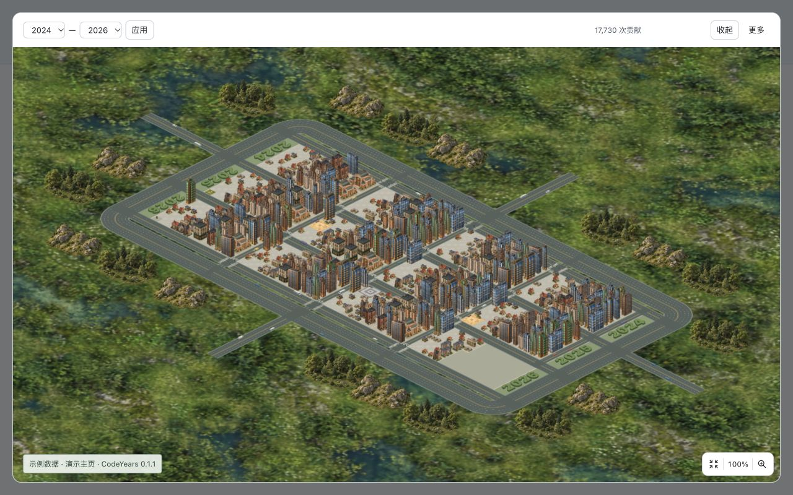

# CodeYears

**代码岁月，自成风景。**

CodeYears 是免费的 Manifest V3 浏览器扩展，将 GitHub 个人主页中当前会话可见的真实每日贡献呈现为一座城市。**0.1.0 City 已在 Chrome Web Store 上架；当前源码为0.1.1**，包含紧凑缩放工具条、初始150%取景和约93%的包体缩减。维护者已确认0.1.1于2026-11-04提交商店审核，尚未确认更新上线。Edge 尚待独立验收。

[官网](https://xingyu.wang/extensions/codeyears) · [隐私政策](https://xingyu.wang/extensions/codeyears/privacy) · [GitHub 版本与安装包](https://github.com/wxy/CodeYears/releases) · [0.1.1 版本说明](docs/releases/v0.1.1.md)



## 使用方式

允许扩展在 GitHub 运行后，个人贡献区出现文件夹式“城市 / 贡献图”标签，默认仍显示 GitHub 原图。点击城市后才加载面板、确认当前会话并读取历史，默认最近三年。先显示完整空场地与道路，再随已校验年度数据填入地块；未知、未返回和未来日期不补零。读取、取消、警告和失败在画布浮层内显示，正常完成后隐藏。

修改年份范围后点击“应用”。滚轮或按钮缩放、拖动平移，聚焦城市画布后用方向键平移，“全景”恢复取景；可在当前页面内展开同一画布，按Esc、点击遮罩或“收起”返回。原图与活动概览一同切换，页面下方的活动流水保留。切回原图、页面隐藏或导航时取消并释放城市，再进入重新核对身份。缩放不改变数量和建筑合并。

“更多”按主页操作与帮助分组，可刷新或清除当前主页缓存；帮助与图例可折叠。点击菜单外部或按Esc关闭菜单。可在其中选择英文、简体中文或跟随浏览器。界面双语不表示所有GitHub网页语言都能解析：当前贡献来源主要验证英文页面。GitHub页面结构或访问权限变化可能导致读取停止，失败不会当作零贡献。

扩展图标左键仍快捷打开当前GitHub主页的城市；在扩展图标上使用浏览器原生右键菜单的“选项”，可设置全局界面语言，并查看版本、帮助、隐私与反馈入口。语言保存后会联动GitHub页内入口，刷新后仍保留偏好。

调整取景后，在画布上右键使用浏览器原生保存或复制图片菜单。没有独立导出或分享服务；正式入口不提供暂停、继续、跳过或重播。

## 城市与数据

按ISO完整周组织年度街区，每13周道路分段，同档相邻日期可按支持的矩形占地合并，不跨道路或缺失日期，保留原始日期、数量与成员明细。周年范围的边界日期可能与GitHub公历年不同，合计须按同一日期范围比较。

当前固定分档为0自然地块/城市邻域铺装、1–2平房、3–5低层、6–19公寓、20–49办公楼、50+大厦。已接入普通住宅、别墅、庭院住宅和横纵联排等低层素材；道路、河道与外围景观仅作装饰。占地、高度与造型不是某类真实GitHub活动的推断。

无需GitHub Token或独立登录，没有后端、广告或遥测。年度日期/数量在浏览器本地按访问者、主页与年份隔离缓存；身份无法确认时不复用缓存。只向GitHub请求，不自动上传图片。详见 [隐私说明](PRIVACY.md) 与 [数据边界](docs/DATA_AND_PRIVACY.md)。

截图是正式City渲染器与入口在受控外壳中的合成示例，不是真实登录主页或私有活动。[图片来源、对应版本和复现方法](docs/store/city-0.1.1/README.md)。0.1.1素材与验收范围见 [预烘焙报告](docs/reports/CITY-PREBAKED-ASSETS.md)。

## 文档入口

下表早期报告按各自提交保留，包含历史控件与视图；不代表当前正式入口功能或验收状态。

| 文档 | 内容 |
| --- | --- |
| [产品定义](docs/PRODUCT.md) | 已确认决策、使用流程、范围与后续设想 |
| [技术架构](docs/ARCHITECTURE.md) | 模块边界、数据流、生命周期与当前骨架 |
| [开发路线](docs/ROADMAP.md) | 数据与性能验证 → City MVP → City 发布，Terrain 暂缓 |
| [执行计划](docs/DEVELOPMENT_PLAN.md) | 工作包、依赖、PR 切分与阶段验收 |
| [云端开发](docs/CLOUD_DEVELOPMENT.md) | Codex 环境配置、首次任务与本地验收边界 |
| [数据与隐私](docs/DATA_AND_PRIVACY.md) | 数量准确性、身份隔离、缓存和权限待验证项 |
| [性能约束](docs/PERFORMANCE.md) | 20 年数据验证方法、按需渲染、资源释放 |
| [用户隐私说明](PRIVACY.md) | 读取范围、本地缓存、删除及权限用途 |
| [City 首发准备](docs/RELEASE_READINESS.md) | 发行候选、已完成项和发布前门槛 |
| [商店材料候选](docs/STORE_LISTING.md) | 中英文候选文案、权限字段依据与正式示例截图 |
| [初始化验证记录](docs/reports/BOOTSTRAP.md) | 实际检查结果与未完成验收范围 |
| [P1-A 任务](docs/tasks/P1-A.md) | 年度数据诊断的范围、运行方式与并行边界 |
| [P1-B 任务](docs/tasks/P1-B.md) | 访问者隔离、年度缓存及本地/云端分工 |
| [P1-B 验证记录](docs/reports/P1-B-VIEWER-CACHE.md) | 实际检查、输入规则与真实环境待验收范围 |
| [P1-G 可行性进度](docs/reports/P1-G-READINESS.md) | 本机 Metal 负载、显示调度基线与剩余验收门槛 |
| [60 Hz 补充验证](docs/reports/P1-G-60HZ.md) | 内建屏幕六组约 60 FPS 的原型证据 |
| [主线审查与对接复核](docs/reports/MAINLINE-2026-10-31.md) | 年度组装/匿名报告合入、时间轴对接候选验证与下一步 |
| [City 体验报告](docs/reports/CITY-EXPERIENCE-PREVIEW.md) | 单年份真实贡献之城、缓存重播与本地交互预览 |
| [多年份体验报告](docs/reports/MULTI-YEAR-CITY.md) | PR #12/#13 合入、三年真实城市与二十年示例展示 |
| [年份风景报告](docs/reports/YEAR-LANDSCAPES.md) | PR #14 合入、City 年份城区、Terrain、切换与释放 |
| [连续景观报告](docs/reports/CONTINUOUS-LANDSCAPES.md) | 前一版连续画面及旧版真实 MV3 的版本化证据 |
| [融合景观报告](docs/reports/SCENIC-UI.md) | 前版透明背景、连续山脉及整体生长证据 |
| [城市图样报告](docs/reports/CITY-TYPOLOGIES.md) | 历史 3D 图样版的贡献植被、相邻合并与道路验证 |
| [标定城市接入报告](docs/reports/CALIBRATED-CITY-INTEGRATION.md) | 当前新单元、季度道路、清晰近景与 Chrome MV3 直接路径 |

## 本地开发

使用Node.js 22.12+（22系列）或24+、npm；依赖版本由锁文件固定。

```sh
npm ci
npm run check
npm run build
```

在Chrome的 `chrome://extensions` 加载 `dist/`，允许扩展在GitHub运行。修改后重新构建并重载扩展；`npm run dev` 可监听构建，不向扩展注入开发服务器代码。City使用Canvas 2D和包内透明素材，点击后按需加载；静止停止连续帧，离开释放资源。

制作本地发行候选需要Python3：`npm run package:city` 生成 `release/codeyears-0.1.1-city.zip` 与SHA-256。产物不提交Git，打包不等于验收、商店上传或发布。ZIP内容和最终运行检查由 [发布清单](docs/RELEASE_READINESS.md) 记录；旧0.1.0冻结包保留。

素材检查可运行 `npm run preview:units`，打开 [本地标定预览](http://127.0.0.1:4176/)。`probes/` 中的历史体验/负载工具包含旧播放控件，只用于开发；不代表正式入口功能或支持范围。[菜单与键盘PR #47](https://github.com/wxy/CodeYears/pull/47) 的分组、菜单外部/Esc关闭、同一画布展开返回和方向键平移已在本地真实Chrome验证。[选项页PR #48](https://github.com/wxy/CodeYears/pull/48) 已由用户从原生“选项”切换English，看到Saved并确认刷新后保留、GitHub入口联动英文。英文菜单边界、点击遮罩收起与Esc焦点恢复也已在真实Chrome复核。每日数据表已按用户决定从首发界面移除，精确数据继续供内部渲染与校验。具体版本、性能与未测范围见 [本地报告](docs/reports/CITY-FIRST-RELEASE-LOCAL.md)。

## 当前状态与许可

#46–#54已合入，首发运行代码未因后续文档和媒体更新而改变；#35独立分享实验已关闭。首发仅提供City；未上线的视图或主题不属于当前功能。紧凑缩放工具条（全景图标、比例、最大图标）按用户决定留到下一版本，目前仍使用原有加减与全景按钮。性能、真实MV3和安装/更新提示以对应版本报告为准，不继承旧原型约60FPS的结论。用户已取消专门隔离账户和A/B登录切换验收；该范围未覆盖，不再作为索取第二账户的条件。

仓库 [wxy/CodeYears](https://github.com/wxy/CodeYears) 已公开，尚无已核实的商店下载链接。商店提交状态来自用户确认；GitHub里程碑与Chrome审核结果分别记录，GitHub安装包不表示商店已通过。代码采用 [MIT](LICENSE)；[素材分发边界](ASSETS.md) 与 [第三方依赖许可](THIRD_PARTY_NOTICES.md) 分开说明。来源登记不等于对所有第三方权益作法律保证，也不授予位图独立MIT许可。
