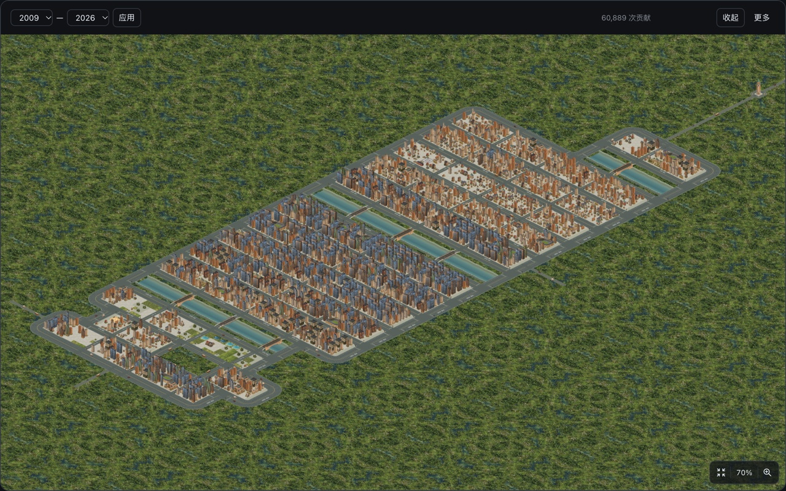

# CodeYears

**代码岁月，自成风景。**

CodeYears 是免费的 Manifest V3 浏览器扩展，将 GitHub 个人主页中当前会话可见的真实每日贡献呈现为一座城市。**已发布的 GitHub 版本为 0.1.2**，增加随活动分布变化的城市轮廓、更多住宅与公共建筑、道路和桥梁细节、建筑悬停摘要，以及同页地图复用。保留 CodeYears 名称。维护者确认0.1.2已于2026-11-08提交Chrome商店审核，尚未确认审核通过或新版上线；GitHub发布与商店状态分别记录，见[发布清单](docs/RELEASE_READINESS.md)。Edge 尚待独立验收。

[官网](https://xingyu.wang/extensions/codeyears) · [隐私政策](PRIVACY.md) · [Chrome 商店](https://chromewebstore.google.com/detail/codeyears/mhbphbpbjbndjhodbdmijdopidhcibia) · [GitHub 版本与安装包](https://github.com/wxy/CodeYears/releases) · [0.1.2 版本说明](docs/releases/v0.1.2.md)



## 使用方式

点击浏览器工具栏上的 CodeYears 图标，在弹窗选择「大规模城市」、「微缩城市」或「关闭」。界面语言、版本号和帮助、隐私、反馈也在同一个弹窗里。本机保存展示方式、道路开关和语言偏好。

**大规模城市（默认）。** 个人贡献区提供「城市 / 贡献图」页签，初始显示 GitHub 原图。点击城市页签、弹窗里的「打开当前主页的城市」或城市直达链接后，会加载城市并读取历史，默认最近三年。

**微缩城市。** 在 GitHub 原贡献图的尺寸内，用小建筑和可开关的浅灰道路呈现当前日历。画布底色跟随 GitHub 主题。图例从空地到四档建筑，年份切换、日期点选与提示继续由 GitHub 提供。

**关闭。** 显示原样的 GitHub 贡献图。

### 浏览大规模城市

城市先显示空场地与道路，再随已校验年度数据填入地块。读取、取消、警告和失败在画布浮层内显示，正常完成后隐藏。

修改起止年份后城市自动更新。两端交叉时，另一端跟随你刚选的年份，形成单年范围。合计旁显示实际覆盖的起止日期。滚轮或按钮缩放、拖动平移，聚焦城市画布后用方向键平移，“全景”让城区、已命名的出城路牌和返程牌完整入画。可在当前页面内展开同一画布，按 Esc、点击遮罩或“收起”返回。初始 100% 对应旧版 150% 的取景，最大不超过 2000%，较小城市也受素材细节上限约束。缩放不改变数量和建筑合并。

切回 GitHub 原图时，原生贡献图和活动概览一起恢复，完整城市留在页内内存。切换浏览器标签页时，公开城市保留画布、展开状态和取景，回到前台即可续看。本人城市在后台暂时隐藏，在回到前台时静默核对身份，再复用仍有效的画布。身份暂时无法核实时可重试，确认换号、刷新、清除缓存或离开主页会释放旧城市。

“更多”按主页操作与帮助分组，可刷新或清除当前主页缓存；帮助与图例可折叠。打开「更多 → 路牌和出口从哪里来？」可查看出口、返程牌和外环组织牌的来源。也可以直接点地图上的空白出口牌，查看如何在自己的 GitHub 简介中用 `@用户名` 连接朋友。点击菜单外部或按Esc关闭菜单。可在其中选择英文、简体中文或跟随浏览器。界面双语不表示所有GitHub网页语言都能解析：当前贡献来源主要验证英文页面。GitHub页面结构或访问权限变化可能导致读取停止，失败不会当作零贡献。

调整取景后，在画布上右键使用浏览器原生保存或复制图片菜单。没有独立导出或分享服务；正式入口不提供暂停、继续、跳过或重播。

## 城市与数据

按ISO完整周组织年度街区，每13周道路分段，同档相邻日期可按支持的矩形占地合并，不跨道路或缺失日期，保留原始日期、数量与成员明细。周年范围的边界日期可能与GitHub公历年不同，合计须按同一日期范围比较。

当前固定分档为0自然地块/城市邻域铺装、1–2平房、3–5低层、6–19公寓、20–49办公楼、50+大厦。已接入更多住宅、商铺、公共及文化交通建筑；活动地块决定城区轮廓，长空闲区保留为野外，分离城区以道路连接。年度共用道路与季度道路加宽并标注英文名称；车辆、红绿灯、河道和两种桥梁属于静态景观。每次进入城市时重新布车，缩放、拖动和从后台标签页返回时保留当次车阵。普通建筑的占地、高度与造型不是某类真实GitHub活动的推断。

悬停建筑可高光并查看简短浮层：时间规律、相关仓库，以及能取得的提交、PR、评审和Issue数量汇总；不列具体事项标题。活动记录不是完整统计，缺少部分记录时数量用下限表示。停留后按需读取，详情在当前页内按访问者与主页隔离复用五分钟；没有项目时保留时间概括。若所选范围包含主页最早年份的首个活跃日，扩展会在读到该年时核对当天活动。记录明确写有“Joined GitHub”时，那一天首次入画就显示为单格注册纪念塔。首个仓库及加入组织建筑尚未接入。

本人主页使用核实后的会话贡献，其他主页、退出登录和未知身份使用匿名公开日历。点选、悬停或聚焦地图后按 Enter 可查看建筑的日期和准确贡献数。年度缓存仅存本地。城市沿用主页 Bio 中个人账号的出现顺序，给当前地图的出城道路填上蓝色路牌，绿色牌可沿本次旅程返程。外环边的组织广告牌汇集主页已列出的组织，点牌可打开组织主页。无需 GitHub Token 或独立登录，没有后端、广告或遥测。详见 [隐私说明](PRIVACY.md) 与 [数据边界](docs/DATA_AND_PRIVACY.md)。

上方截图来自维护者wxy自己的GitHub贡献页，使用正式0.1.2扩展在本机Chrome直接拍摄，展示2009–2026年的60,889次贡献快照。另有800%建筑近景及400%公开项目悬停摘要的完整中英文组。[图片来源、规格与拍摄方法](docs/store/city-0.1.2/README.md)。0.1.2检查与验收边界见[发行报告](docs/reports/CITY-0.1.2-RELEASE.md)。

## 文档入口

下表早期报告按各自提交保留，包含历史控件与视图；不代表当前正式入口功能或验收状态。

| 文档 | 内容 |
| --- | --- |
| [产品定义](docs/PRODUCT.md) | 已确认决策、使用流程、范围与后续设想 |
| [技术架构](docs/ARCHITECTURE.md) | 模块边界、数据流、生命周期与当前骨架 |
| [开发路线](docs/ROADMAP.md) | 数据与性能验证 → City MVP → City 发布，Terrain 暂缓 |
| [执行计划](docs/DEVELOPMENT_PLAN.md) | 工作包、依赖、PR 切分与阶段验收 |
| [云端开发](docs/CLOUD_DEVELOPMENT.md) | Codex 环境配置、首次任务与本地验收边界 |
| [数据与隐私](docs/DATA_AND_PRIVACY.md) | 数量准确性、身份隔离、缓存和权限待验证项 |
| [性能约束](docs/PERFORMANCE.md) | 20 年数据验证方法、按需渲染、资源释放 |
| [用户隐私说明](PRIVACY.md) | 读取范围、本地缓存、删除及权限用途 |
| [City 首发准备](docs/RELEASE_READINESS.md) | 发行候选、已完成项和发布前门槛 |
| [商店材料候选](docs/STORE_LISTING.md) | 中英文候选文案、权限字段依据与正式示例截图 |
| [初始化验证记录](docs/reports/BOOTSTRAP.md) | 实际检查结果与未完成验收范围 |
| [P1-A 任务](docs/tasks/P1-A.md) | 年度数据诊断的范围、运行方式与并行边界 |
| [P1-B 任务](docs/tasks/P1-B.md) | 访问者隔离、年度缓存及本地/云端分工 |
| [P1-B 验证记录](docs/reports/P1-B-VIEWER-CACHE.md) | 实际检查、输入规则与真实环境待验收范围 |
| [P1-G 可行性进度](docs/reports/P1-G-READINESS.md) | 本机 Metal 负载、显示调度基线与剩余验收门槛 |
| [60 Hz 补充验证](docs/reports/P1-G-60HZ.md) | 内建屏幕六组约 60 FPS 的原型证据 |
| [主线审查与对接复核](docs/reports/MAINLINE-2026-10-31.md) | 年度组装/匿名报告合入、时间轴对接候选验证与下一步 |
| [City 体验报告](docs/reports/CITY-EXPERIENCE-PREVIEW.md) | 单年份真实贡献之城、缓存重播与本地交互预览 |
| [多年份体验报告](docs/reports/MULTI-YEAR-CITY.md) | PR #12/#13 合入、三年真实城市与二十年示例展示 |
| [年份风景报告](docs/reports/YEAR-LANDSCAPES.md) | PR #14 合入、City 年份城区、Terrain、切换与释放 |
| [连续景观报告](docs/reports/CONTINUOUS-LANDSCAPES.md) | 前一版连续画面及旧版真实 MV3 的版本化证据 |
| [融合景观报告](docs/reports/SCENIC-UI.md) | 前版透明背景、连续山脉及整体生长证据 |
| [城市图样报告](docs/reports/CITY-TYPOLOGIES.md) | 历史 3D 图样版的贡献植被、相邻合并与道路验证 |
| [标定城市接入报告](docs/reports/CALIBRATED-CITY-INTEGRATION.md) | 当前新单元、季度道路、清晰近景与 Chrome MV3 直接路径 |

## 本地开发

使用Node.js 22.12+（22系列）或24+、npm；依赖版本由锁文件固定。

```sh
npm ci
npm run check
npm run build
```

在Chrome的 `chrome://extensions` 加载 `dist/`，允许扩展在GitHub运行。修改后重新构建并重载扩展；`npm run dev` 可监听构建，不向扩展注入开发服务器代码。City使用Canvas 2D和包内透明素材，点击后按需加载；静止停止连续帧，完整场景同页隐藏时保留、离开主页时释放。

制作本地发行候选需要Python3：`npm run package:city` 生成 `release/codeyears-0.1.2-city.zip` 与SHA-256。同版本同内容可重新打包；若同名存档内容不同，脚本会保留原文件。其他本地候选可在构建后运行 `python3 scripts/package-city.py --output-dir <目录>`。须使用干净的构建目录；可运行 `python3 scripts/verify-city-package.py release/codeyears-0.1.2-city.zip` 核验版本、权限、资源和文件字节。产物不提交Git，打包不等于验收、商店上传或发布。ZIP内容和最终运行检查由 [发布清单](docs/RELEASE_READINESS.md) 记录；既有正式版本附件保留。

素材检查可运行 `npm run preview:units`，打开 [本地标定预览](http://127.0.0.1:4176/)。`probes/` 中的历史体验/负载工具包含旧播放控件，只用于开发；不代表正式入口功能或支持范围。[菜单与键盘PR #47](https://github.com/wxy/CodeYears/pull/47) 的分组、菜单外部/Esc关闭、同一画布展开返回和方向键平移已在本地真实Chrome验证。[选项页PR #48](https://github.com/wxy/CodeYears/pull/48) 已由用户从原生“选项”切换English，看到Saved并确认刷新后保留、GitHub入口联动英文。英文菜单边界、点击遮罩收起与Esc焦点恢复也已在真实Chrome复核。每日数据表已按用户决定从首发界面移除，精确数据继续供内部渲染与校验。具体版本、性能与未测范围见 [本地报告](docs/reports/CITY-FIRST-RELEASE-LOCAL.md)。

## 当前状态与许可

仅提供City；未上线的视图或主题不属于当前功能。0.1.2基于已合入的#63–#65、#69和#70，五个城市打磨实验#71–#75未纳入。性能、真实MV3和安装/更新提示以对应版本报告为准，不继承旧原型约60FPS的结论。用户已取消专门隔离账户和A/B登录切换验收；该范围未覆盖，不再作为索取第二账户的条件。

仓库 [wxy/CodeYears](https://github.com/wxy/CodeYears) 已公开，并有[Chrome商店条目](https://chromewebstore.google.com/detail/codeyears/mhbphbpbjbndjhodbdmijdopidhcibia)。GitHub发布与Chrome审核结果分别记录，GitHub安装包不表示商店已通过。代码采用 [MIT](LICENSE)；[素材分发边界](ASSETS.md) 与 [第三方依赖许可](THIRD_PARTY_NOTICES.md) 分开说明。来源登记不等于对所有第三方权益作法律保证，也不授予位图独立MIT许可。
