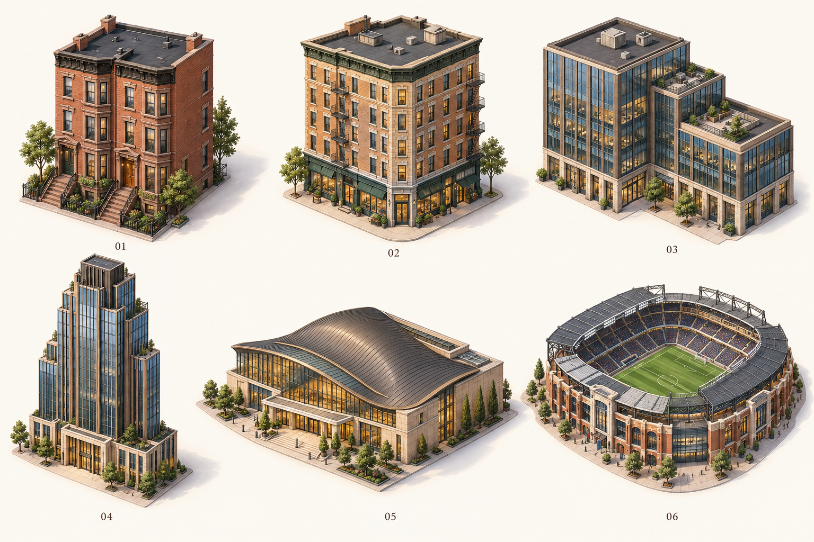

# CodeYears

**代码岁月，自成风景。**

CodeYears 是完全免费的 Chrome / Edge Manifest V3 浏览器扩展项目，计划把 GitHub 多年的真实每日贡献数量呈现为 **City（贡献之城）**与 **Terrain（时光山脉）**。

> 当前 City 已接入 **22 款新透明单元与 3 款旧中高层建筑**的共享标定数据，涵盖建筑、单树、树林、草地、水体与广场。每年一条横向街区，周为列、周一至周日为行；季度交叉道路分段，建筑按地面包络居中留距。固定视角，支持缩放、平移与重置；缩放不改变建筑和合并结果。整体视觉、二十年性能预算与完整浏览器路径仍待验收，PR #15 已按用户授权合入。

根据实测反馈，City 已将灰白整块底面改为绿地庭院、建筑铺装与入户步道，沿合并地块边界连接窄支路；放大上限按实际投影尺寸计算，允许从多年全景进入建筑细节。上述改动仍待最终视觉验收。

已完成 [第二轮单元设计](docs/design/city-units/v2/README.md)：设计板覆盖含 3×3 的 13 种建筑组合，实际运行目录只使用已制作并标定的素材，尚未补齐全部组合和双变体。可运行 `npm run preview:units` 打开 <http://127.0.0.1:4176/> 查看 [标定数据](docs/design/city-units/v2/calibration/README.md)。警局、消防局、体育场、总站按标定后的低矮比例使用，不将其原定 H1 目标写成已完成；原 PNG 保留。景观带从所选最早年份起，每五年分组。



## 已确认的方向

- 完全免费，不要求 GitHub Token 或独立登录，没有后端。
- 在 GitHub 个人主页，利用现有会话与同源贡献页面请求，按年获取真实每日数量；可行性与解析规则先验证。
- 数据本地按年缓存，按登录访问者身份隔离；主页所有者不等于访问者。
- 仅 City 与 Terrain，不开发独立 Classic 或 Orbit；保留 GitHub 原生贡献图。
- Apple 式精致克制设计，Signature / Natural 两种主题。
- Time Travel 从平地整体生长，即使缓存完整也可重播；支持暂停、跳过。
- 用户主动激活才加载景观，静止停止连续帧，离开释放 WebGL 资源，优先保障 GitHub 原页面体验。

## 文档入口

| 文档 | 内容 |
| --- | --- |
| [产品定义](docs/PRODUCT.md) | 已确认决策、使用流程、范围与后续设想 |
| [技术架构](docs/ARCHITECTURE.md) | 模块边界、数据流、生命周期与当前骨架 |
| [开发路线](docs/ROADMAP.md) | 数据与性能验证 → City MVP → Terrain → 发布 |
| [执行计划](docs/DEVELOPMENT_PLAN.md) | 工作包、依赖、PR 切分与阶段验收 |
| [云端开发](docs/CLOUD_DEVELOPMENT.md) | Codex 环境配置、首次任务与本地验收边界 |
| [数据与隐私](docs/DATA_AND_PRIVACY.md) | 数量准确性、身份隔离、缓存和权限待验证项 |
| [性能约束](docs/PERFORMANCE.md) | 20 年数据验证方法、按需渲染、资源释放 |
| [初始化验证记录](docs/reports/BOOTSTRAP.md) | 实际检查结果与未完成验收范围 |
| [P1-A 任务](docs/tasks/P1-A.md) | 年度数据诊断的范围、运行方式与并行边界 |
| [P1-B 任务](docs/tasks/P1-B.md) | 访问者隔离、年度缓存及本地/云端分工 |
| [P1-B 验证记录](docs/reports/P1-B-VIEWER-CACHE.md) | 实际检查、输入规则与真实环境待验收范围 |
| [P1-G 可行性进度](docs/reports/P1-G-READINESS.md) | 本机 Metal 负载、显示调度基线与剩余验收门槛 |
| [60 Hz 补充验证](docs/reports/P1-G-60HZ.md) | 内建屏幕六组约 60 FPS 的原型证据 |
| [主线审查与对接复核](docs/reports/MAINLINE-2026-10-31.md) | 年度组装/匿名报告合入、时间轴对接候选验证与下一步 |
| [City 体验报告](docs/reports/CITY-EXPERIENCE-PREVIEW.md) | 单年份真实贡献之城、缓存重播与本地交互预览 |
| [多年份体验报告](docs/reports/MULTI-YEAR-CITY.md) | PR #12/#13 合入、三年真实城市与二十年示例展示 |
| [年份风景报告](docs/reports/YEAR-LANDSCAPES.md) | PR #14 合入、City 年份城区、Terrain、切换与释放 |
| [连续景观报告](docs/reports/CONTINUOUS-LANDSCAPES.md) | 前一版连续画面及旧版真实 MV3 的版本化证据 |
| [融合景观报告](docs/reports/SCENIC-UI.md) | 前版透明背景、连续山脉及整体生长证据 |
| [城市图样报告](docs/reports/CITY-TYPOLOGIES.md) | 历史 3D 图样版的贡献植被、相邻合并与道路验证 |
| [标定城市接入报告](docs/reports/CALIBRATED-CITY-INTEGRATION.md) | 当前新单元、季度道路、清晰近景与 Chrome MV3 直接路径 |

## 本地开发

使用 Node.js 22.12+（22 系列）或 24+、npm。依赖版本由 `package-lock.json` 固定。

```sh
npm ci
npm run check
npm run build
```

在 Chrome 的 `chrome://extensions` 或 Edge 的 `edge://extensions` 开启开发者模式，选择“加载已解压的扩展”，选择本项目的 `dist/` 目录。在 GitHub 个人主页贡献日历加载完成后，点击扩展图标，再选择“打开 CodeYears”。选择起止年份（默认最近三年，也可选择更早起点或相同年份）及 City / Terrain，点击生成。逐年读取时显示进度，全部完成后展示风景，可拖动平移、滚轮缩放、重置视图、暂停/继续、跳过或重播；同时显示各年概览。切换视图不重新请求，保留生长进度与相机；生长百分比不表示已呈现到某个真实日期。还可仅查看每日数量、强制刷新整个范围、清除此访问者在当前主页的缓存、取消或关闭风景。每日明细在展开时才建立，避免预先插入数千行。使用缓存前仍会联网确认身份；后台隐藏时清空显示、销毁风景并取消请求，返回后需重新生成。

不安装扩展也可先体验画面：运行 `npm run preview:city`，打开 <http://127.0.0.1:4175/>，可切换 City / Terrain、一年/三年/二十年，以及系统/浅色/深色页面外观。City 的缩放仅调整画面大小，不重新采样或改变建筑。年度街区按工作周排列，相邻同强度档的格子按实际支持占地合并，保留真实日期和数量，不跨季度道路。当前阈值为 0 平地、1–2 幼树、3–5 树木、6+ 建筑，具体阈值尚未冻结；建筑主色来自原素材。数据地块中的草地、池塘与广场表示零贡献平地；五年景观带内的树木、水体和道路只作装饰。Terrain 继续使用跨年份连续高度场。这个本地预览使用明确标记的确定性示例数据，复用同一风景渲染器；它不是独立产品网站，也不读取 GitHub 会话。

`npm run dev` 监听源文件并重新构建；修改后在扩展管理页重新加载。它不向扩展注入开发服务器代码。

当前 manifest 使用 `activeTab`、`scripting` 与 `storage`：主动点击后临时注入，本地保存按访问者隔离的年度数量；没有持久网站访问、Cookie 权限、自动 content script 或后台服务。生成风景时才动态加载本地 `landscape.js`；City 使用 Canvas 2D，按当前场景实际需要加载随包 PNG，将标定结果一次烘焙为长边不超过 384 像素的透明画布供播放复用，随后释放源位图。只有选择 Terrain 才导入 Three.js 分包并创建 WebGL。manifest 沿用向 GitHub 声明的本地资源范围，本轮未增加权限；本轮真实 Chrome 已确认默认三年新素材加载、近看和关闭；专项示例覆盖全部运行单元。Edge 和完整身份/权限验收仍待完成，范围见 [本轮报告](docs/reports/CALIBRATED-CITY-INTEGRATION.md)。

## 目录

```text
public/manifest.json        MV3 清单
popup.html                  扩展状态页入口
src/extension/              弹窗与按需注入的 Shadow DOM 风景 / 数据面板
src/platform/github/        页面上下文、年度同源请求原型
src/data/                   每日贡献数据契约与年度校验解析器
src/cache/                  作用域年度缓存、版本与有效期校验
src/timeline/               与数据加载解耦的播放控制器
src/renderers/              融合年份街区的 City / 连续 Terrain 及工程原型
probes/city/                复用风景渲染器的本地示例体验
docs/                       产品、架构、路线与验证记录
```

Three.js 位于按需 Terrain 分包，弹窗、注入脚本和 City 不静态导入它。`probes/rendering` 仍用于旧版 20 年 City / Terrain 工程负载检查，与当前风景实现的验收结论分开。

## 当前下一步

PR #15 已保留提交历史合入；新一轮任务按 [云端与本地分工](docs/tasks/CITY-PARALLEL-2026-10-31.md) 并行推进，各自通过独立 PR 交付。新单元、季度道路、共享标定与稳定合并已接入；当前先收敛整体视觉和细节观看体验，再补实际需要的素材组合、二十年性能预算、正式主题及 P1-G 的真实身份矩阵、Edge、后台与导航验收。不继承旧工程原型约 60 FPS 的结论，也不把设计板目录或首轮标定当成完整美术验收。

GitHub 仓库 [wxy/CodeYears](https://github.com/wxy/CodeYears) 已于 2026-10-29 按用户决定公开；尚未选择开源许可证。扩展尚未发布，没有商店下载链接。独立网站仅是扩展成功后的后续设想，当前不建设。
