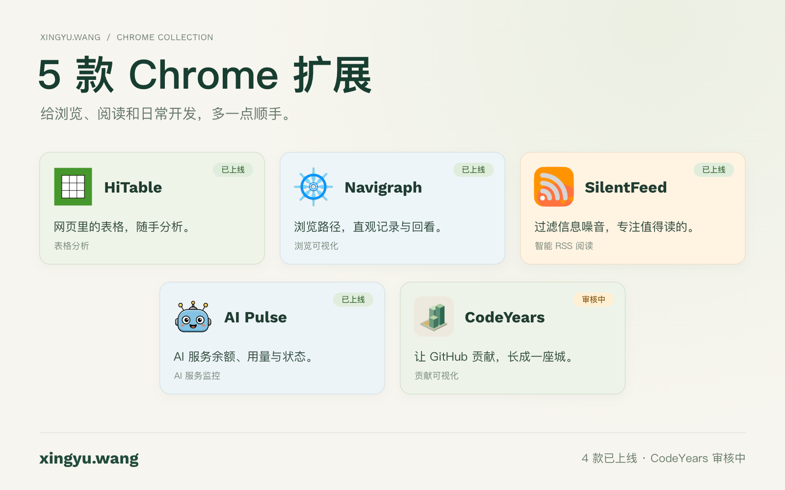

# 五款 Chrome 扩展 · X 展示海报

状态：2026-11-03制作完成，未上传、草拟或发布到X。只准备正式静态图片。CodeYears 0.1.0 GitHub里程碑已发布，Chrome Web Store仍在审核；用户已明确同意海报写“5 款 Chrome 扩展”，单独注明CodeYears审核中。

图片：[five-chrome-extensions.png](five-chrome-extensions.png)，1600×1000 RGB PNG，454463 bytes，SHA-256 `64b8ba54250aef5468bddbaa8b885485fbde71e182de2a84e10a267bbc3dc279`。正式导出副本位于项目忽略目录 `release/codeyears-five-chrome-extensions.png`，便于本机直接选择。

## 内容与来源

| 产品 | 图上用途 | 状态依据 | 图标来源 |
| --- | --- | --- | --- |
| HiTable | 网页里的表格，随手分析 | 用户确认已上线；个人网站已有商店链接 | xingyu.wang/public/icons/hitable.png |
| Navigraph | 浏览路径，直观记录与回看 | 同上 | xingyu.wang/public/icons/navigraph.png |
| SilentFeed | 过滤信息噪音，专注值得读的 | 同上 | xingyu.wang/public/icons/silentfeed.png |
| AI Pulse | AI服务余额、用量与状态 | 同上；明确为Chrome扩展，不是macOS/iOS产品 | xingyu.wang/public/icons/ai-pulse-chrome.png |
| CodeYears | 让GitHub贡献，长成一座城 | 用户再次明确仍在Chrome商店审核 | 本仓库public/icons/codeyears-512.png |

图标原样复制到icons目录作为可复作的正式设计输入，没有重绘或修改其他项目源码。前四款产品介绍取自个人网站当前产品注册表；商店页面读取失败，未据此声称独立完成商店可用性或安装验证。海报不包含安装量、用户量、认证或排名等未核实数据。

图上标题只描述五款作品，四款标“已上线”，CodeYears用单独的“审核中”标记；页脚再次说明数量与状态，不把刚提交的第五款写成已发布。仅用个人网址作入口，没有替用户上传或发表社交内容。

## 验证与复作

- 浏览器画布直接导出正式PNG，原尺寸完整解码、1600×1000、RGB无alpha和文件哈希检查通过；小于5MB。
- 本机Chrome独立窗口检查五个图标、名称、用途、状态、正文换行、边缘与留白。原始PNG已再次目视核对，没有中文缺字或裁切。
- 1600×1000为8:5横版；X官方说明单图2:1至3:4的常见比例可完整展示。本次没有实际上传，平台压缩与发布预览未验收。[X图片说明](https://help.x.com/en/using-x/posting-gifs-and-pictures)
- 设计方向见[ART_DIRECTION.md](ART_DIRECTION.md)，可维护的正式构图代码见[SOURCE.md](SOURCE.md)。仅增加宣传文件，不改变扩展行为、权限、发行包或既有运行素材，无需扩展编译或端到端回归。
- 临时画布页面、HTTP服务和过程输出在交付后清理；只保留正式PNG、五枚输入图标、设计源稿和本报告。

图片替代文本：暖白背景上展示五款Chrome扩展，三加二排列HiTable、Navigraph、SilentFeed、AI Pulse和CodeYears的正式图标、名称与简短用途。前四款标已上线，CodeYears标审核中；页脚为xingyu.wang和“4款已上线·CodeYears审核中”。

## 图标指纹

| 文件 | SHA-256 |
| --- | --- |
| icons/ai-pulse-chrome.png | `08400f2d4b9f3e81d2d3e9e0d53b9c568c9cb9c0c07c8b2a4ad6f40da04e9224` |
| icons/codeyears.png | `78af45ad60c0c3e7ac3cbc904a50c462a6156e6a44933d0f1c2cf8ebe4f1ce72` |
| icons/hitable.png | `9c1848e5d6bda72b003f553f28bc301252b9c63870eea0293a9c89e575034984` |
| icons/navigraph.png | `e80db6ae276952f6d4c7453991bb801a1a1ff95e8ddde6c8cc792a60c080f51e` |
| icons/silentfeed.png | `2cf66283602fa232cfa82c465e4c60d1d00ce50de0b5abc89cd62895793deb2e` |
