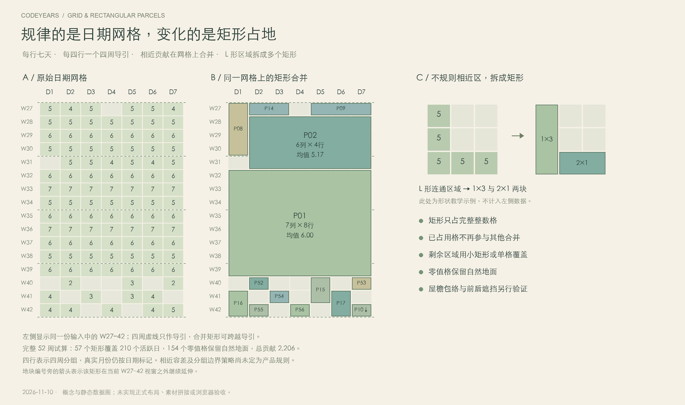
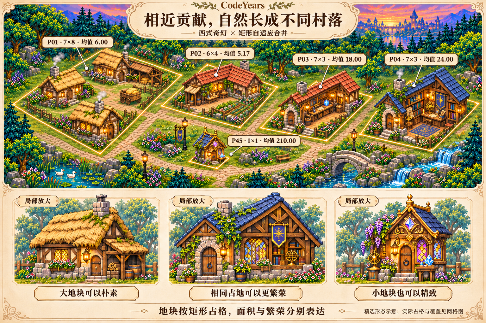

# 西式奇幻 · 七列网格与矩形自适应合并

状态：**2026-11-10 设计研究与独立渲染原型**。用户明确采用西式奇幻风格，在每周七天一行的日期网格上，把贡献相近的区域合成不同大小的地块。本目录包含概念图、真实数据试算和独立本机渲染原型，未接入正式扩展。

## 真实数据的房屋渲染

最新版本把固定房屋位置、院落退让、草坪与连接小路纳入绘制，并将同繁荣档、能形成完整矩形的相邻原地块合成更大庭院。相同真实输入下，三年从 **315 栋主屋减至 270 栋**，最大庭院由 4 格增至 8 格；低贡献大地块绘制菜畦，高贡献大地块保留花园和铺装。原始 7,709 次公开贡献、443 个活跃日及七列日期邻接关系不变。

本机输出三年总览（6000×3400）、2026 街区近景（4000×2500）和 2025 农场近景（3200×2400）。根因、合并候选规则、相同输入校验值、实际浏览器验证及限制见 [庭院与农场修订记录](REAL-RENDER-COURTYARDS.md)。图像工具只生成通用房屋素材，实际日期、地块、数量与外观档位由程序决定；真实布局图只存本机，未接入正式扩展。

[初版真实数据渲染](REAL-RENDER.md) 保留 315 栋的总览与 67 栋的近景作为历史对照。本轮三年数据 SHA-256 均与该初版一致；更早 [真实贡献试算](REAL-PROFILE-TRIAL.md) 的 2026 合计为 5,947，不能混作本轮 5,950 的快照。正式多格建筑目录仍待补齐。

## 真实贡献页试算

已用 `wxy` 的 2024、2025 和 2026 年匿名公开贡献页试算。当前 25% 相近条件下，活跃日到合并单元分别为 71→48、150→101、222→166，三年最大面积均只有 4 格；2026 将容差放宽到 50% 后为 148 个单元、最大 6 格。真实数据中的日间变化使当前规则仍产生大量单格，不能把下方合成概念中的大片村落当作真实常态。

来源、口径、完整结果、可复算方法与验证范围见 [真实公开贡献试算报告](REAL-PROFILE-TRIAL.md)。真实页面响应、逐日数组、地块明细和临时脚本不进入 Git；用户查看的最终数据图保存在本机。没有修改正式扩展或确定新的阈值。

## 规则网格保证邻接，矩形占用避免地块交叉

- 底层固定七列，每行一周；每四行提供四周导引。真实公历月份按日期标记，四周分组不取代实际月份。
- 自适应合并发生在网格上，单元为不同宽高的整数矩形，坐标和边界共用同一套格子。
- 相近区呈 L 形或 T 形时，拆成几个矩形；合并占用的格子不再参与后续合并，剩余区域可用较小矩形或单格覆盖。
- 日期、零值自然地面和建筑地块完整对应。零值格有自然地面，不因不放建筑而丢失日期。
- 矩形占用互斥只保证地面地块不交叉。正式建筑还需屋檐/地面包络、退让和入口约束；等轴视角的正常前后遮挡另需正确绘制顺序。
- 四周导引在本轮试算中不是强制切块线，矩形可跨越导引；是否把某些分组边界作为硬约束尚未确定。

图中 A 与 B 使用同一份输入中的 W27–42，C 的五格 L 形为单独的形状教学示例。地块编号旁的箭头表示该矩形在当前视窗之外延续。完整 52 周的逐格归属见 [ADAPTIVE-PLAN.md](ADAPTIVE-PLAN.md)。

## 面积与繁荣独立表达，造型采用西式奇幻

西式奇幻造型参考 Agent Control Plane 的实际原图，采用陡坡山墙、半木构、石砌烟囱、铅框/彩色玻璃、奇幻工坊与行会。屋顶、材料、平面和陈设完成度表达繁荣，建筑高度不承担贡献等级。

面积来自能合并的相近贡献范围，区域平均贡献决定繁荣形态；大地块可以是普通村庄，小地块也可以是精致工坊。建筑自身可以有 L 形平面、侧翼和庭院，保留的地面占地仍须是合法矩形。

| 单元 | 占地（星期列 × 周行） | 成员日数 | 总贡献 | 区域均值 | 形态候选 |
| --- | --- | --- | --- | --- | --- |
| P01 | 7×8 | 56 | 336 | 6.00 | 朴素村落，少量屋舍组成一个单元 |
| P02 | 6×4 | 24 | 124 | 5.17 | 普通半木构民居/作坊 |
| P03 | 7×3 | 21 | 378 | 18.00 | 较完善的工匠作坊 |
| P04 | 7×3 | 21 | 504 | 24.00 | 更繁荣的奇幻行会 |
| P45 | 1×1 | 1 | 210 | 210.00 | 小而精致的奇幻工坊 |

美术图只选取五个单元研究形态，没有按完整 57 个地块的日历坐标重现整个场景。图中的三个下方细节明确标记局部放大。世界尺寸、图片透明包络和门窗尺度尚未正式标定，不能把插画当作素材拼接已通过。

## 同一输入与自适应试算

[DATA.md](DATA.md) 保留原始 52 周 / 364 天输入，共 2,206 次贡献、210 个活跃日；SHA-256 不变。旧文件中的固定 4 周 / 13 周结果已标为历史研究，当前不采用固定时间窗口合并。

本轮用临时条件 `最大值 - 最小值 <= max(2, 0.25 × 区域均值)` 示意贡献相近，再从符合条件的矩形中贪心选择不重叠单元。这个容差、候选排序及零值处理是设计试算，**不是用户已确认的产品规则或已实现的算法**。

结果为 57 个不同尺寸的矩形单元，完整覆盖全部 210 个活跃日；154 个零值格保留自然地面。贡献合计仍为 2,206。单元可以是一栋建筑或少量建筑组成的村落，因此单元数不等于最终物理房屋数。

完整坐标、成员值范围、均值、选择方法和可重复代码见 [ADAPTIVE-PLAN.md](ADAPTIVE-PLAN.md)。当前采用的七列方向是星期列 × 周行，所有矩形宽度不超过 7。

## 提示词、来源与正式文件

- [PROMPT-GRID.md](PROMPT-GRID.md)：当前矩形占地与标注修订的完整提示词。
- [PROMPT-ADAPTIVE.md](PROMPT-ADAPTIVE.md)：西式奇幻自适应形态图的完整提示词，保留为当前美术图的生成来源。
- [REFERENCE-ACP.md](REFERENCE-ACP.md)：Agent Control Plane 实际参考文件路径及 SHA-256；其中旧固定窗口段落已标为前版记录。
- [PHILOSOPHY.md](PHILOSOPHY.md)：当前视觉原则。

| 当前文件 | 用途 | 实际尺寸 |
| --- | --- | --- |
| `10-western-fantasy-rectangles.png` | 西式奇幻形态与矩形占地示意 | 1536 × 1024 RGB |
| `11-weekly-grid-rectangles.png` | 七列日期网格、矩形合并与 L 形拆分 | 2600 × 1540 RGB |

美术图使用内置 `image_gen.imagegen`，实际输入用户指定的 Agent Control Plane 原图，未使用独立 API。精确网格图直接由原始数字和矩形结果用 Pillow 绘制。参考项目及前版图片保留，未复制参考项目运行素材到 CodeYears。

## 前版研究记录

- [08 · 初版西式奇幻形态](08-western-fantasy-adaptive.png)、[09 · 转置前的数据地块图](09-adaptive-merge-map.png)：保留周列 × 星期行方向的前版研究；当前正式占地按七列日期网格转置，不以这两图的宽深标注为准。
- [06 · ACP 风格固定窗口](06-merged-regions-acp.png)、[07 · ACP 同占地形态](07-building-forms-acp.png)、[提示词](PROMPTS-ACP.md)。
- [04 · 固定窗口扩大合并](04-merged-regions-v2.png)、[05 · 同占地形态](05-building-forms-v2.png)、[说明](MERGING-V2.md)、[提示词](PROMPTS-V2.md)。
- [01 · 首轮时间片区](01-region-comparison.png)、[02 · 首轮疏密](02-maturity-density.png)、[03 · 旧窗口数据图](03-data-comparison.png)、[提示词](PROMPTS.md)。

前版图片都是正式概念研究记录，不是当前布局或合并规则的依据。

## 早期网格概念图验证与未完成范围

以下记录仅对应早期概念素材和网格文档，当时按风险进行静态核对及图片查看。后续独立绘图代码已执行真实本机浏览器路径，结果以上方两份渲染报告为准；没有修改正式扩展。

- 重新解析 364 个原始值并核对 SHA-256、2,206 次贡献与 210 个活跃日。
- 运行 ADAPTIVE-PLAN.md 中的复算代码，核对 57 个矩形的坐标、相近条件、均值、编号及无重叠覆盖；所有宽度不超过 7。
- 逐格检查：210 个活跃日恰好归属一个矩形，154 个零值格保留自然地面，没有重复或遗漏贡献。
- 核对 W27–42 视窗的矩形裁切与延续标记；L 形教学示例由 1×3 和 2×1 两块覆盖五格，互不重叠。
- 正式 PNG 可完整解码，Markdown 引用存在，实际图片及文字已查看，暂存差异检查通过。
- 提交仅含正式设计图和 Markdown。临时试算、绘图脚本及中间 JSON 位于系统临时目录，记录完成后清理，不进入 Git。

具体相近阈值、素材尺寸目录、跨分组策略和零值参与方式仍待确定；正式素材包络、道路衔接、日期命中与性能待后续实现验证。
