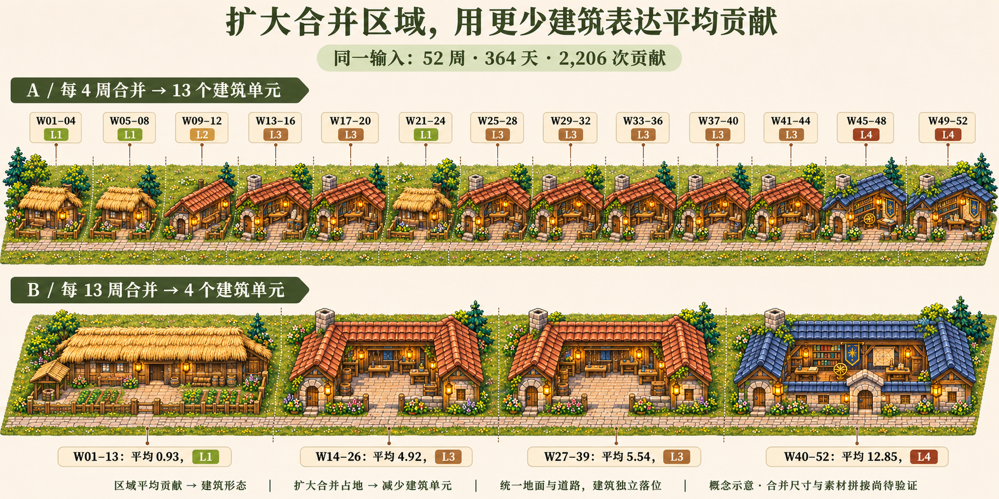
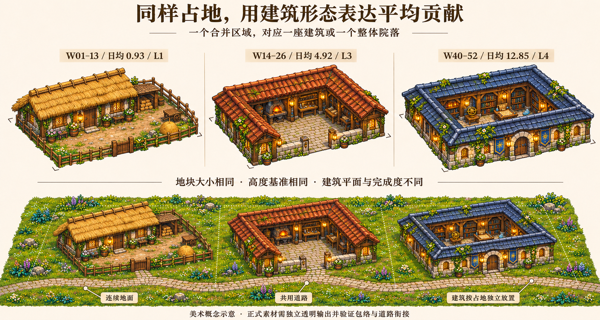

# 古代城镇概念对照 · Agent Control Plane 视觉参考

状态：**供用户选择方向的概念稿，2026-11-10 修订**。视觉设计按用户指定参考 Agent Control Plane，实际传入该项目的工坊、行会和城镇原图。多个日期格合成更大的地块，以较少建筑表达区域平均贡献。当前未实现古代主题；具体合并尺寸、阈值与正式素材规范仍待确认。

## 当前概念：扩大占地，减少建筑单元

两种方案沿用相同的 52 周 / 364 天合成输入、2,206 次贡献和同一成熟度阈值：

| 方案 | 每单元覆盖 | 建筑单元数 | 主要观察 |
| --- | --- | --- | --- |
| 每 4 周合并 | 28 个日期格 | 13 | 较多小单元保留局部均值变化 |
| 每 13 周合并 | 91 个日期格 | 4 | 较少大单元容纳完整院落与回廊形态 |

每个合并区域对应一座建筑或一个具有连续主体的院落，成员日期可以具有不同贡献档。整体平均值决定形态，活跃日期比例不决定建筑数量。已知零值日计入分母，原始日期与数量保留。

本例所有合并区域均有非零平均值，因此分别得到 13 和 4 个建筑单元。完整 13 周占地只是尺度比较候选，不能据此确定最终必须每 13 周放一栋建筑；正式设计还需比较更适合道路与素材包络的较大矩形地块。

## 同样占地，通过形态表达平均贡献

图中三个 13 周区域沿用原输入：W01–13 日均 0.93、W14–26 日均 4.92、W40–52 日均 12.85。用茅草农舍围院、赭红瓦顶工坊院落、蓝灰瓦顶行会/藏书院落表达形态与完成度变化。细致像素、深色木梁、苔石、藤蔓、暖灯和开敞立面的陈设参考 Agent Control Plane。形态与完成度为主，颜色辅助识别，高度不作为贡献等级编码。

拼接策略是统一地面、道路、投影与占地，将独立透明建筑素材落入地块。较大占地使用专门设计的平面形态，门窗尺度应保持一致；不能把小建筑整体等比放大来填满。当前美术图尚未做精确尺度和包络标定，不构成素材无缝拼接、浏览器命中或正式渲染验收。

合并规则见 [MERGING-V2.md](MERGING-V2.md)，当前视觉参考、实际输入文件及校验值见 [REFERENCE-ACP.md](REFERENCE-ACP.md)，完整提示词见 [PROMPTS-ACP.md](PROMPTS-ACP.md)。以上仍为概念，没有修改现代 City 的合并逻辑或运行素材。

## 原始数据和评分

- 固定输入为 52 周 / 364 天，2,206 次贡献、210 个活跃日；不使用真实账户，也不绑定当前公历年。
- 区域平均 = 区域总贡献 / 全部已知成员日数，真实零值计入分母。两种合并尺度共用绝对分级阈值，不按各自最大值重新归一化。
- W14–26 与 W27–39 分别日均 4.92 和 5.54，均为 L3，因此在 13 周方案中都对应一个相近形态的作坊院落。它们的 7/91 与 89/91 活跃日统计不用于额外增减房屋。
- 逐日数字、数据 SHA-256、13 个短区块和 4 个长区块的平均值与等级，见 [DATA.md](DATA.md)。
- 4 周与 13 周边界并不重合，W13、W26、W39 附近存在跨越长片区边界的短片区；试算保留完整固定窗口。

## 首轮讨论图

扩大合并后的前版布局仍可参考：[04 · 合并尺度](04-merged-regions-v2.png)、[05 · 同占地形态](05-building-forms-v2.png)、[前版提示词](PROMPTS-V2.md)。这三份保留为前版记录，当前美术方向以 Agent Control Plane 参考图为准。

首轮扩大评级范围、按活跃比例表现多栋建筑的组织方式，已经由上述扩大合并区域方案修正。以下图片保留为正式讨论记录，不作为当前建筑数量或疏密映射的依据：

- [01 · 首轮片区尺度对照](01-region-comparison.png)
- [02 · 首轮成熟度 × 疏密对照](02-maturity-density.png)
- [03 · 精确数据图](03-data-comparison.png)：数值、分组和评级仍适用；其中将活跃分布关联到空间疏密的说明属于首轮假设。
- [首轮提示词](PROMPTS.md)

## 素材与制作

| 文件 | 用途 | 实际尺寸 |
| --- | --- | --- |
| `06-merged-regions-acp.png` | 当前 Agent Control Plane 风格合并尺度对照 | 1774 × 887 RGB |
| `07-building-forms-acp.png` | 当前同占地形态与连续地面 | 1717 × 916 RGB |
| `04-merged-regions-v2.png` | 前版扩大合并区域对照 | 1774 × 887 RGB |
| `05-building-forms-v2.png` | 前版同占地形态与共用地面 | 1717 × 916 RGB |
| `01-region-comparison.png` | 首轮讨论记录 | 1536 × 1024 RGB |
| `02-maturity-density.png` | 首轮讨论记录 | 1464 × 1074 RGB |
| `03-data-comparison.png` | 从原始数字绘制的评级图 | 3000 × 1770 RGB |

新图由内置 `image_gen.imagegen` 制作，实际输入用户指定的 Agent Control Plane 原图作为视觉参考，没有使用独立图像 API。原始参考文件和前版概念均保留，未复制参考项目的运行素材到 CodeYears。设计原则见 [PHILOSOPHY.md](PHILOSOPHY.md)。图片和逐日表是用户请求的正式概念成果，不属于测试过程截图或临时模拟缓存。

## 验证与未完成范围

本轮仅更新概念图片和文档，未改变控制流、接口、素材装载或构建配置，按风险采用静态核对和实际图片查看；没有运行构建或浏览器端到端测试。

- 重新解析 52 行逐周输入，核对 364 天、输入 SHA-256、2,206 次贡献和 210 个活跃日。
- 复算 13 个 28 天单元与 4 个 91 天单元；每个方案覆盖全部输入且不重复，平均值、等级与文档一致。
- 实际查看新版概念中 13 / 4 个建筑单元、等级顺序、平均值标签、整体院落、连续地面和共用道路，并对照实际参考查看像素、木石、屋瓦、暖灯和工坊/行会陈设。插画中的像素包络、人尺度及独立透明素材尚未标定验证。
- 所有正式 PNG 可完整解码，文档图片和本地引用存在；`git diff --check` 通过。
- 本轮静态核对以内联命令执行，没有新增测试过程文件；上一轮临时脚本和元数据已清理。提交只包含正式概念图片与 Markdown。

可重复的数据复算方法见 `DATA.md` 的最后一节。用户尚未选择最终合并尺寸、均值阈值与建筑目录，正式拼接、日期命中和性能验收仍待后续实现。
