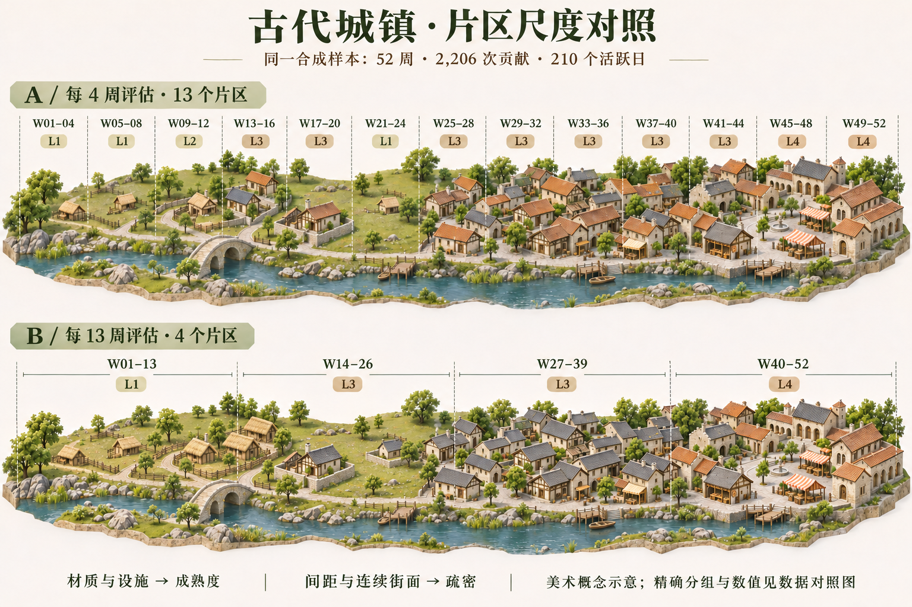
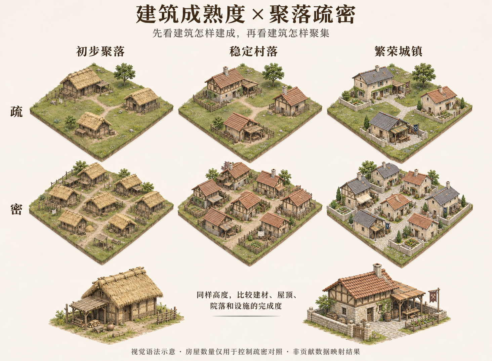
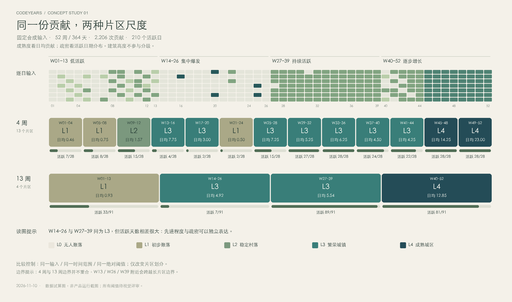

# 古代城镇概念对照 · 2026-11-10

状态：**供用户选择方向的概念稿**。本轮制作美术图和数据试算图，没有实现古代主题、修改现代 City、接入数据请求或调整产品既有映射规则。评分阈值、区块跨度和建筑规范均待确认。

## 查看图片

### 01 · 同数据的片区尺度总览



上排按连续 4 周划分，共 13 个片区；下排按连续 13 周划分，共 4 个片区。两排依据同一组固定贡献数据、同一时间范围和相同成熟度阈值制作，画面保持接近的镜头、尺度与地形。

建筑材质、屋顶、院落和公共设施表达成熟度；草地间隔、独立院落与连续街面表达疏密。生成插画不承担逐栋计数或精确地理坐标验证；实际数值和分组以第三张数据图及输入表为准。

正式图采用定向修订后的版本：下排第一片区统一为粗木/茅草聚落，第二片区保留稀疏分布并统一为较完善的石木建筑，第三片区使用相近成熟度的连续街面，第四片区形成完整的低层城区。未把首轮未修订图加入本目录。

### 02 · 建筑成熟度与疏密的独立表达



三列为初步聚落、稳定村落、繁荣城镇，两行为疏和密。用相同面积的地块、近似相同建筑尺度，观察“稀疏但建造完善”和“密集但建造简单”能否独立读懂。此图是独立的视觉语法研究，不是 52 周贡献输入的另一种统计结果；房屋组合数量用于说明疏密，不对应贡献次数。

### 03 · 精确数据与评级对照



此图使用 Pillow 从输入数字直接绘制，不由图像模型生成数值。背景为浅色设计版面，逐日图、片区边界、等级和活跃比例均从同一数组计算。

## 输入与试算口径

- 固定合成输入：52 周、364 天，**2,206 次贡献、210 个活跃日**。不使用真实账户数据，也不绑定当前公历年。
- 数据包含低活跃、集中爆发、持续活跃和逐步增长四段。逐日原始数字、数据校验值、两种分组结果及复算方法见 [DATA.md](DATA.md)。
- 成熟度采用片区内日均贡献，共用绝对阈值；活跃天数及其分布用于讨论空间疏密。真实零值日计入分母。
- W14–26：448 次贡献，7/91 个活跃日，日均 4.92，L3；W27–39：504 次贡献，89/91 个活跃日，日均 5.54，同为 L3。这是检验成熟度与疏密能否独立表达的关键对照。
- 4 周边界与 13 周边界并不重合；较短片区在 W13、W26、W39 附近可能跨越较长片区边界。数据图保留真实边界，不把短片区强制拆成 4+4+4+1。

## 本轮观察与待决定事项

| 观察维度 | 每 4 周评估 | 每 13 周评估 |
| --- | --- | --- |
| 短期变化 | 更容易看到局部成熟度切换 | 会平滑短期变化 |
| 建筑语言 | 同一段时间附近的材质变化更多 | 更容易形成统一的城镇片区 |
| 集中爆发 | W13–20 的 L3 与 W21–24 的 L1 明显区分 | W14–26 共享 L3，但内部仍保留大面积空地 |
| 持续活跃 | 连续多个小片区共享 L3 | 一个完整 L3 街区，结构更连贯 |
| 逐步增长 | W41–44 保留 L3，W45 起进入 L4 | W40–52 统一为 L4，淡化区间内发展过程 |

概念图支持继续讨论“用材质与院落完成度表达成熟度、用空间分布表达疏密”的方向。13 周更容易组织完整的城镇，4 周更容易保留时间节奏；本轮不把某一种划分写为已确认产品决策。图像生成会带来局部体量、细节和地形差异，不能替代正式单元包络、逐日命中、日期守恒或渲染性能验收。

## 素材与制作方式

| 文件 | 用途 | 实际尺寸 |
| --- | --- | --- |
| `01-region-comparison.png` | 片区尺度总览，定向修订版 | 1536 × 1024 RGB |
| `02-maturity-density.png` | 成熟度 × 疏密近景 | 1464 × 1074 RGB |
| `03-data-comparison.png` | 同输入的精确评级图 | 3000 × 1770 RGB |
| [PHILOSOPHY.md](PHILOSOPHY.md) | 视觉设计原则 | 文档 |
| [PROMPTS.md](PROMPTS.md) | 两张初始图与定向修订的完整提示词 | 文档 |
| [DATA.md](DATA.md) | 正式概念输入和试算结果 | 文档 |

两张美术图由内置 `image_gen.imagegen` 生成，第一张经过一次定向修订；未调用独立图像 API、未复用第三方美术素材。第三张以 Pillow 及本机 STHeiti / Arial 字体绘制。图片和逐日表为本次请求的正式设计成果，不属于测试过程截图或临时模拟缓存。

## 验证与边界

本轮只有文档和概念素材，未更改控制流、接口、素材装载或构建配置，因此采用静态核对及实际图片查看；没有运行构建或浏览器端到端测试，也不宣称古代主题已在扩展中可用。

- 从 `DATA.md` 重新解析 52 行逐周输入，核对每行 7 个非负整数、周合计、活跃天数及完整 364 天范围。
- 核对展平数组 SHA-256，分别复算 13 个短片区和 4 个长片区；两种结果总量均为 2,206，活跃日合计均为 210，各自覆盖全部 52 周且不重复。
- 重新计算全部片区的日均、活跃比例和成熟度，核对输入表中的展示值；检查片区连续性及共用阈值。
- 三张 PNG 解码完整，实际尺寸如上；逐张查看标题、主要标注、两种分区与视觉层次，数据图的标注未溢出画布。
- `git diff --check` 通过。提交仅包含本目录正式图片和 Markdown；临时生成/核对脚本与元数据放系统临时目录，完成后清理。

可重复的输入核对命令（在本目录执行）：

```sh
python3 - <<'PY'
from pathlib import Path
import hashlib, json
rows = [line for line in Path('DATA.md').read_text().splitlines()
        if line.startswith('| W') and len(line.split('|')) == 12]
weeks = [[int(v.strip()) for v in row.split('|')[2:9]] for row in rows]
days = [value for week in weeks for value in week]
assert len(weeks) == 52 and len(days) == 364
assert sum(days) == 2206 and sum(v > 0 for v in days) == 210
assert hashlib.sha256(json.dumps(days, separators=(',', ':')).encode()).hexdigest() == \
    'b3bf1875db6618a0ca2987a4c4028e768296ceecdb9fb23441e456f36941e46a'
for span in (4, 13):
    chunks = [days[start:start + span * 7] for start in range(0, len(days), span * 7)]
    assert sum(map(sum, chunks)) == sum(days)
    assert sum(sum(v > 0 for v in chunk) for chunk in chunks) == 210
    print(span, len(chunks), sum(map(sum, chunks)))
PY
```
