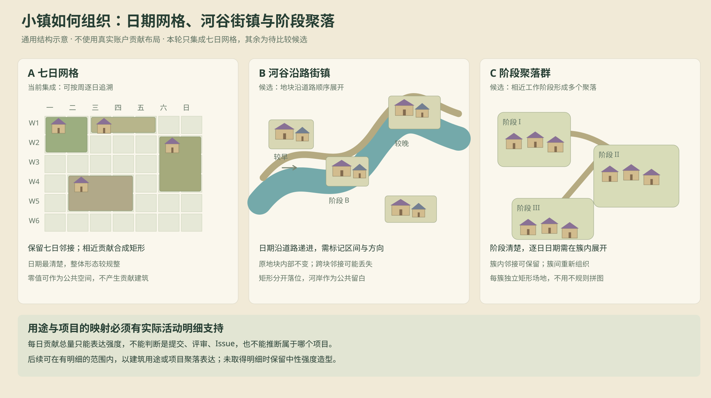

# 日期网格之外的小镇组织候选

日期：2026-11-11。状态：**设计比较**。本轮正式地图类型先保留已确认的七日一行网格；下方两种方案未实现，不搭建多布局框架。

图中没有使用真实账户布局或虚构贡献数量；示意中的阶段、建筑和公共空间仅解释组织方式。

| 比较 | 七日网格，当前集成 | 河谷沿路街镇，候选 | 阶段聚落群，候选 |
| --- | --- | --- | --- |
| 主要组织 | 星期列 × 周行，相近贡献合成矩形 | 原矩形作为完整单元，按时间沿道路展开 | 将同一工作阶段的原矩形组成一个聚落 |
| 日期可读性 | 最直接，可按行列追溯 | 需要明确道路方向、区间标签和日期详情 | 阶段清楚，日级日期须在簇内展开 |
| 原邻接关系 | 保留原网格邻接 | 保留原地块内部邻接，跨块邻接可能丢失 | 可保留簇内邻接，跨簇重新组织 |
| 拼接与互斥 | 共用整数网格，矩形互斥 | 独立矩形沿路摆放，河岸作为间隔 | 每簇使用独立矩形场地，不以不规则多边形拼图 |
| 公共空间 | 已知零值日期可放装饰性设施 | 道路、河岸和块间留白承载设施 | 聚落中心和连接路承载设施 |
| 主要待决 | 四周导引与矩形合并尺度 | 多年跨度、时间方向和跨块邻接损失能否接受 | 工作阶段如何划分，能否稳定呈现并保留追溯 |

贡献类型与项目是另一条信息维度，不能由贡献总量推断。只有取得并验证实际活动明细后，才能让建筑用途区分提交、评审、Issue，或让聚落表达实际项目；未取得明细时应继续使用中性强度形态，不把炼金师、法师或农夫当作贡献类型事实。

当前地图类型的差异首先来自相近贡献合并、面积与繁荣分离、低矮平面建筑组、院落和公共设施。未来如比较河谷或阶段聚落，应固定同一真实输入，明确日期映射及邻接损失，再验证矩形占用与贡献守恒。
