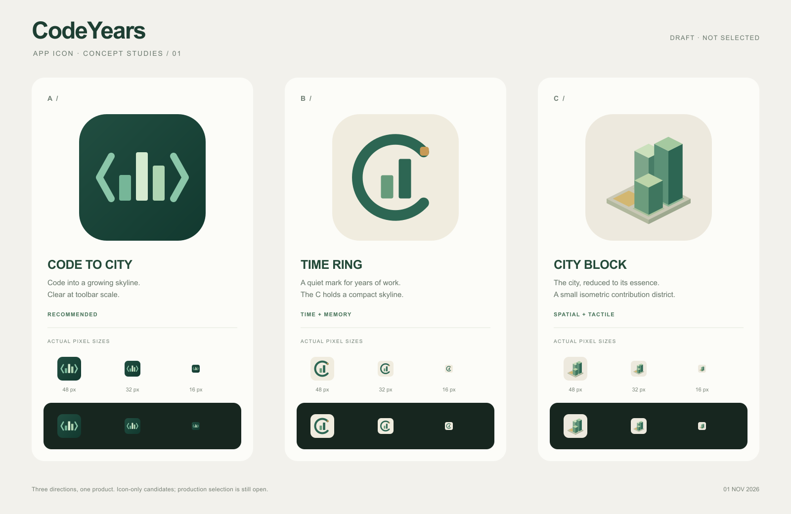

# CodeYears 应用图标提案 · v1

日期：2026-11-01。状态：三套独立候选，尚未选定正式图标。使用 SVG Logo Designer 流程进行原生矢量设计；这不是当前城市渲染素材，也没有替换扩展图标或修改 manifest。



| 方向 | 创意 | 适合之处 | 取舍 |
| --- | --- | --- | --- |
| **A · 代码成城（推荐）** | 代码括号围住三座高低楼宇，贡献逐渐积累成城；深松绿与薄荷、浅叶绿构成主识别 | 一眼联系代码与城市，轮廓简单，工具栏小尺寸仍能辨认 | 抽象轮廓比场景感更强，时间含义主要由 CodeYears 名称承载 |
| B · 时间环 | 用开放的 C 形时间环包住城市，琥珀色贡献刻度强调岁月中的一个节点 | 更强调 CodeYears 的“年”和持续积累，可扩展为长期品牌符号 | 比 A 更接近通用时间/数据标志，城市识别需要内部双塔辅助 |
| C · 等轴街区 | 以固定 2:1 等轴投影呈现三座阶梯楼宇和一块琥珀地砖 | 与实际贡献之城的观看角度呼应，温润、有空间感 | 16 px 时楼体层次比 A 更紧密，优先看整体剪影 |

三个方向都不使用 GitHub 标志、日期数字或细小窗格；不把完整城市截图缩进图标。B 的时间环是品牌隐喻，不代表新增 Orbit 视图。

## 文件与规格

- `codeyears-a-code-city.svg`：A 的 512×512 原生矢量母版。
- `codeyears-b-time-ring.svg`：B 的 512×512 原生矢量母版。
- `codeyears-c-city-block.svg`：C 的 512×512 原生矢量母版。
- `proposal-board.svg`：可编辑比较板，内部复用三套矢量符号，无外链图片、脚本或字体请求。
- `proposal-board.png`：1600×1040 正式提案板。48/32/16 px 样张按这些实际像素尺寸绘制，未放大冒充小尺寸效果。

主体配色为松绿、浅叶绿、暖石色，B/C 以少量琥珀点缀。A 使用轻微底色渐变，其余主体为纯色面；均无滤镜、复杂阴影或装饰文字。图标圆角外为透明，板面用于浅/深背景对照。

## 实际核对

SVG XML 解析通过；使用本机 `rsvg-convert 2.62.3` 导出并目视检查提案板，三组大图、浅深小尺寸及标签均正常。读取 PNG 头部确认1600×1040。命令：

```sh
rsvg-convert -o docs/design/app-icon/v1/proposal-board.png docs/design/app-icon/v1/proposal-board.svg
```

本次只有正式候选与说明，不改变名称、权限、构建或运行行为，因此未运行 npm 编译或浏览器端到端。PNG 是用户要求的正式创意提案，不是测试截图；没有保留测试过程文件。

用户选定方向后，再收敛光学比例、制作发行所需 PNG 尺寸、接入扩展并核对真实工具栏；本提案不宣称已完成正式图标上线或完整品牌规范。
