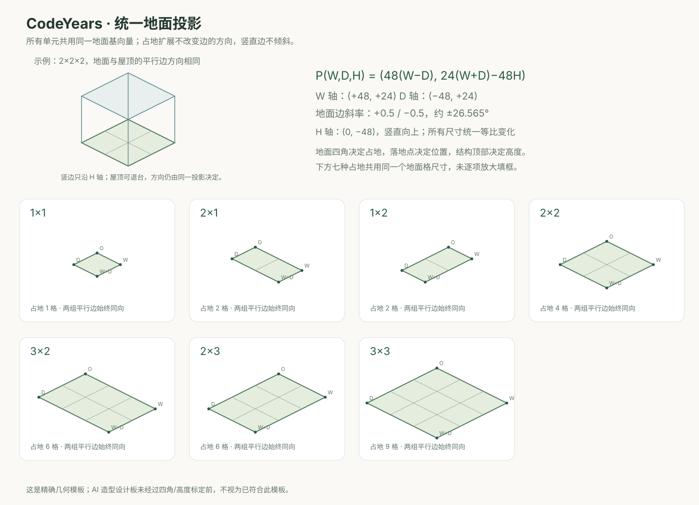
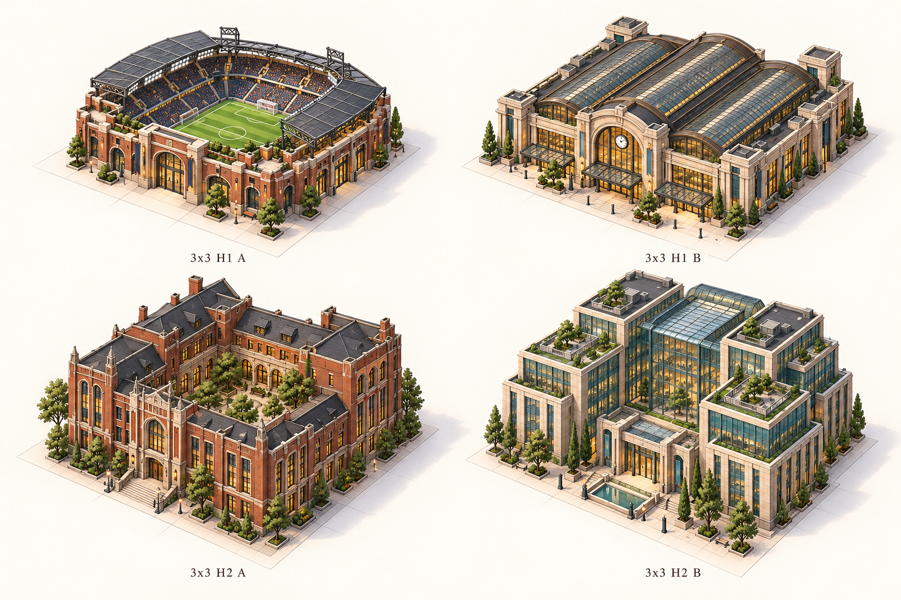

# 城市单元设计 v2

日期：2026-10-31。状态：**八张造型设计板已完成，覆盖 26 款建筑、10 款植被、8 款平地，共 44 个设计方向。** 下表实际制作的 22 款透明单元已完成首轮标定并接入 City，另复用 3 款旧中高层；不把设计标签、首标或运行接入视为全部生产验收。原 PR #15 未合入。

用户本轮增加 3×3，占地与贡献高度继续分开，每个支持组合至少两个造型；要求建筑与地面两组平行边一致。完整规则见 [单元规范](../../CITY_UNIT_SPEC.md)。运行时已从所选最早年份起每五年分组景观带，普通年间道路保留；季度交叉路已按最近整周边界接入，合并不跨路。完整组合与高层双变体仍待补齐。

## 本轮标定

运行 `npm run preview:units`，打开 <http://127.0.0.1:4176/> 查看全部新单元拼接、原始/标定后、浅深背景与缩放；运行 `npm run preview:city` 打开 <http://127.0.0.1:4175/> 查看城市集成。建筑按地面包络居中并留 0.1 格最小试排退让。六款新建筑记录主边映射到 ±0.5，八款平地作四角包络映射，八款植被按根部与单株高度定位。警局、消防局、体育场、总站按实际低矮比例进入 City，不拉高以冒充 H1 目标；自然包络、完整顶部和部分透明边缘仍待复核。详见 [标定数据与说明](calibration/README.md)。原 PNG 均保留未改，运行副本位于 `public/assets/city/unit-*.png`。

## 统一投影与实际状态

模板由明确坐标绘制，不是 AI 估计：`W=(48,24)`、`D=(-48,24)`、`H=(0,-48)`。各占地共用同一格尺寸，地面边斜率为 ±0.5，竖直边不倾斜。楼身与屋顶的对应直边也沿同一轴线，不能只让底座某一条边接近道路。

**设计板主要完成造型、材质和 A/B 差异，图中的网格/高度不是量测结果。** 图片仍存在局部比例、方向和镜头偏差，设计板不直接裁切铺进城市。独立素材的地面包络、落地点、楼身参考和两组主边以就近 JSON 记录；绘制校正不能恢复隐藏几何或保证所有屋顶来自同一物理相机。树木不要求树冠有直边，按根部与单株高度定位。

## 八张设计板

| 设计板 | 组合与变体 | 设计数 |
| --- | --- | ---: |
| [01 · 小占地建筑](01-small-buildings.png) | 1×1 的 H1/H2/H3/H4，各 A/B | 8 |
| [02 · 邻里设施](02-neighborhood-services.png) | 2×1 H1 警局/消防局；1×2 H1 小车站/社区图书馆 | 4 |
| [03 · 方形中高层](03-square-mid-and-high.png) | 2×2 H2 公寓/办公，H4 两种塔楼 | 4 |
| [04 · 横向公共设施](04-wide-public-buildings.png) | 3×2 H1 会展/车站，H2 市政公共楼/图书馆 | 4 |
| [05 · 纵深功能设施](05-deep-functional-buildings.png) | 2×3 H1 体育馆/站房，各不同体量与屋顶 | 2 |
| [06 · 新增3×3](06-large-3x3-buildings.png) | H1 体育场/总站，H2 庭院图书馆/市民中心 | 4 |
| [07 · 植被](07-vegetation.png) | 1×1 灌木/单树，2×1/1×2 树丛，2×2 树林，各 A/B | 10 |
| [08 · 地面与水体](08-ground-and-water.png) | 1×1/2×2 草地，2×2 池塘、广场，各 A/B | 8 |

A/B 至少在体量、屋顶、立面或自然形态上有差异，同时拉开暖砖、浅石、深色金属、蓝灰/青绿玻璃等材质色。功能设施是视觉类型，不对应某种真实 GitHub 活动。

## 独立透明候选

子代理按独立目录并行，每款独立生成，不从设计板裁图；所有候选均保留原始 alpha，未用程序去底、阈值化或修改像素。

| 目录 | 内容 | 来源与实际检查 |
| --- | --- | --- |
| [trees](candidates/trees/) | 宽冠单树、针叶单树，共2款 | [SOURCES](candidates/trees/SOURCES.md) |
| [large-3x3](candidates/large-3x3/) | 体育场、铁路总站，共2款 | [检查说明](candidates/large-3x3/README.md)、[提示与来源](candidates/large-3x3/PROMPTS.md) |
| [services](candidates/services/) | 警局、消防局，共2款 | [SOURCES](candidates/services/SOURCES.md) |
| [ground](candidates/ground/) | 池塘 A/B、广场 A/B，共4款 | [SOURCES](candidates/ground/SOURCES.md) |
| [woodland](candidates/woodland/) | 2×1/1×2 树丛、2×2 树林，各 A/B，共6款 | [SOURCES](candidates/woodland/SOURCES.md) |
| [meadow](candidates/meadow/) | 1×1/2×2 草地，各 A/B，共4款 | [SOURCES](candidates/meadow/SOURCES.md) |
| [residential](candidates/residential/) | 1×1 H1 砖住宅/石材商住，共2款 | [SOURCES](candidates/residential/SOURCES.md) |

以上七组共 22 款独立透明素材，City 通过共享标定绘制，并非原图直接铺图。源文件仍可测到偏离模板，原始来源说明保留实际观察；低值 alpha 仅在显示缓存中抑制，原 PNG 不修改。较高 alpha 晕边、完整几何和深浅背景观感仍待美术验收。

运行目录另外引用 [三款旧中高层标定](calibration/legacy-buildings.md)，并以单树文件生成两种幼树变体，共 27 个 id / 25 个文件。只加载场景实际需要的文件，烘焙长边不超过 384 像素；同文件只解码一次，源位图在烘焙后释放。数据地块内的草地、池塘和广场表示零贡献平地，五年景观带内的水体、树木仅为装饰。数量阈值和最终比例仍未冻结。

## 生成来源与检查

- 使用内置 `image_gen`，设计板每板独立请求，透明候选每款独立请求；没有 CLI/API fallback。
- 八张板以用户已选的 v1 六款建筑总览为风格参考，原始请求、参考角色和工具输出路径保存在 [GENERATION.json](GENERATION.json)。它们是有底色/标签的 RGB 设计图，不是透明运行素材；像素尺寸按实际输出记录，不强称统一。
- 工具原始文件保留在生成目录，项目副本直接复制；正式图和来源记录为设计产物，不是测试截图。独立候选的完整提示/来源/哈希/alpha 检查各自就近维护，便于替换单个候选。
- 已逐板目视检查：组合标签、数量、完整轮廓、造型与材质变化基本符合设计用途；高度存在整体递进，但尚未量测达到 H1:H2:H3:H4 的严格比例，地面网格也不是已标定量尺。没有把“提示要求2:1”写成生成结果已通过。
- 几何模板已在浏览器查看，七种占地使用同一基向量；22 款单元经首轮标定后已按用户授权接入 City 与季度支路，绘制时共用标定工具的同一实现。尚未完成完整建筑组合、全部双变体或最终美术验收。

五年布局的构建和直接路径验证见 [本轮报告](../../../reports/FIVE-YEAR-BANDS-AND-UNITS.md)，不继承旧版本帧率证据。
