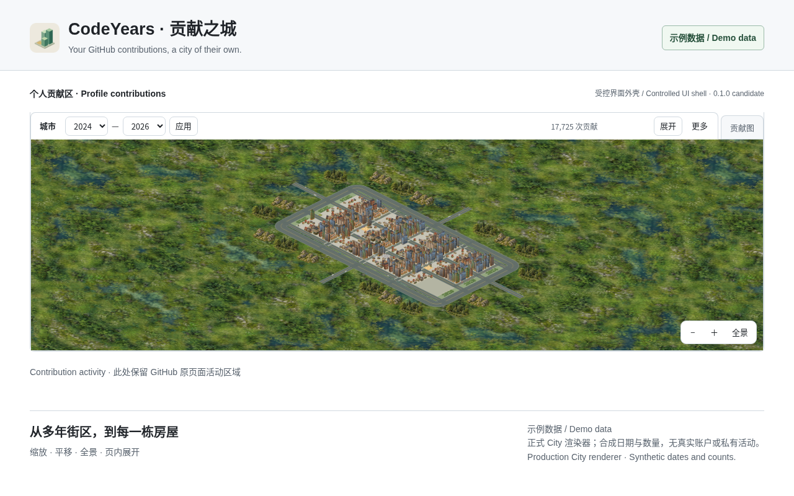
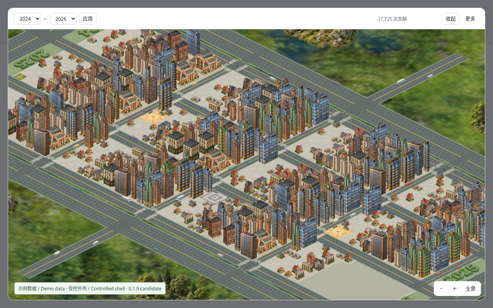

# City 0.1.0 正式商店示例图候选

2026-11-02；未上传或提交商店。截图对应此前源码 `e3a609e84a821b2a792711c888f63f27edc120e5`。两图已由本地审阅确认尺寸、标签与画面可接受；More收起与普通展开外观未变，按本地决定保留原图，不追加宣传图或重截。最终候选源与本地报告以 [首发收尾PR #46](https://github.com/wxy/CodeYears/pull/46) 的组合记录对应，截图元数据不冒充后续功能验收SHA。两张PNG从一开始按商店产品图目标制作，不是验收截图改名；原始捕获直接作为交付，无像素重画、拼贴或后期增加功能。临时外壳/输入/日志/浏览器目录已清理，保留本复现说明与 [尺寸/哈希/算法元数据](screenshots.json)。

| 图片 | 内容 | 规格 |
| --- | --- | --- |
| [01-overview.png](01-overview.png) | 正式页内文件夹标签、2024–2026三年总览；默认原图后实际点击城市加载 | 1280×800，RGB PNG，870,258 bytes |
| [02-closeup.png](02-closeup.png) | 实际点击“展开”，同一画布放大4次后的街区近景 | 1280×800，RGB PNG，1,535,770 bytes |





两图均明确标“示例数据 / Demo data”与受控外壳说明。UI为简体中文，示例/环境标签为双语；没有声称已经制作独立英文UI截图。中文与英文可复制商店文案见 [STORE_LISTING](../../STORE_LISTING.md)。图片为完整方角画面，没有另外添加外框或透明外围；应用自己的圆角展开对话框不等于PNG四角被裁圆。

## 展示环境与来源

使用云端 Chromium154.0.8037.57 / Debian13，headless、禁用GPU，1280×800 CSS像素、DPR1、Asia/Shanghai。没有读取真实GitHub页面、Cookie、私有活动或用户缓存，没有登录测试账户。页面origin通过CDP请求拦截提供受控响应；浏览器看到的地址形似GitHub不构成真实登录页面证据，图上已明确注明外壳。

实际执行固定源码正式构建的 `entry.js`、`content.js`、`landscape.js` 与包内运行图片；未修改程序/图片来生成截图。运行包的脚本哈希见screenshots.json。临时`chrome.runtime.getURL`将文件定位到受控包内资源路径，`chrome.storage`只在内存保存合成缓存/语言，接口替身不验证真实MV3存储。全站请求由CDP接管，不回退联网；favicon空响应，图片和脚本读临时正式构建文件。GitHub样式外壳只提供页面结构、标题与示例说明，不仿造用户头像、仓库或真实活动流水。

沿用既有运行建筑、道路、城郊与图标；未生成新建筑或风景。来源及许可边界引用 [ASSETS.md](../../../ASSETS.md)、[THIRD_PARTY_NOTICES.md](../../../THIRD_PARTY_NOTICES.md)。本地#46已追溯59张运行图并更新来源与现行条款；本任务不更改这些声明，也不把来源登记或截图成功写成对全部法律权益的保证。

## 确定性输入算法

固定时点2026-11-02；按UTC日期从2023-01-01连续迭代到2026-11-02（包括首尾）。2023用于源年入口，默认三年只请求2024、2025与2026。初始seed=20240101，跨年度不重置：

```python
from datetime import date, timedelta
seed = 20240101
start, end = date(2023, 1, 1), date(2026, 11, 2)
day = start
while day <= end:
    seed = (seed * 1664525 + 1013904223) & 0xffffffff
    index = (day - date(day.year, 1, 1)).days
    section = (index // 7) % 13
    count = ((1 if seed % 3 == 0 else 0) if section < 3
             else 1 + seed % 5 if section < 6
             else 6 + seed % 20 if section < 10
             else 25 + seed % 61)
    # 临时按源年分组保存 (day.isoformat(), count)，不写进仓库。
    day += timedelta(days=1)
```

得到2023年365天/6865次，2024年366天/6564次，2025年365天/6388次，2026-01-01至11-02共306天/4773次。默认2024–2026实际显示1037天/17,725次；当年剩余日期没有伪造记录。计数规则只为展示层次，不代表真实活动分布。

## 截图复现步骤

1. 在干净临时目录归档上述固定SHA。按锁文件 `npm ci`、`npm run check`、`npm run build -- --outDir <TMP>/dist`，不得修改运行文件。使用相同Chromium版本、DPR1与1280×800视口，固定浏览器时区Asia/Shanghai。未来复现须在临时外壳的document-start时钟替身中固定Date为2026-11-02（或使用相同日期的受控时钟），避免解析器按后来日期要求不同当年覆盖；不修改产品日期逻辑。
2. 用CDP `Fetch.enable` 拦截所有请求。`https://github.com/codeyears-demo`提供临时受控外壳，`/__codeyears__/...`读取dist同名文件；`chrome.runtime.getURL(path)`返回该前缀。注入内存版storage.get/set/remove、onChanged.addListener和i18n.getUILanguage='zh-CN'。未匹配请求返回空响应，不能放行到真实服务。
3. 外壳用 `body.logged-out`（受控未登录状态，无真实账户），提供 `.js-yearly-contributions > .graph-before-activity-overview`，其中包含 `h2#js-contribution-activity-description` 和内含 `table.ContributionCalendar-grid` 的原图区域。提供2023–2026的`a#year-link-YYYY`，以及独立的活动区域。加载正式entry.js；不手画扩展标签、控件、城市或数量汇总。
4. 外壳排版：白底、系统字体14px/1.6；头部高约114px，padding30px 48px 22px，浅灰底，下方1px边；左侧48px包内图标与“CodeYears · 贡献之城”，英文副题；右侧绿色“示例数据 / Demo data”。main padding26px 48px，原生贡献标题16px；原图区域340px，扩展自行替换。页脚margin24px 48px、上边线与18px上内距。图01中的“受控界面外壳 / Controlled UI shell · 0.1.0 candidate”和图内示例说明都是展示标签，不是产品新增功能。
5. 同路径无query的身份确认响应继续返回logged-out外壳。年度query的`from`决定源年：用算法生成英文 `h2` 年合计、唯一ContributionCalendar-grid的data-date单元和绑定tool-tip。tooltip格式如 `5 contributions on January 1st.`，0用No，月份英文，序数后缀按日期生成。2026仅提供截至固定日的306天。每个年度响应延迟250ms用于可观测的逐年到达，不修改数据或产品动画。源年响应的content-type为text/html，无重定向。
6. 确认入口默认dataset.view='native'，再点击正式shadowRoot中的`#tab-city`。等待正式汇总出现、取消按钮隐藏、status空，Canvas说明显示1037天，More关闭；再等待900ms让实际短填入结束。用 `Page.captureScreenshot({format:'png', captureBeyondViewport:false})`直接写正式图01。不得调用旧预览的跳过/重播来制造完成状态。
7. 点击正式工具栏`#expand`；toolbar随同一panel移动到dialog。点击正式`#zoom-in`四次（倍率1.25⁴≈2.4414，无平移），等待900ms。仅为商店示例说明，在展开dialog内绝对定位一条左下标签（bottom14px,left16px,z-index5，12px系统字体，绿色浅底、6px 9px内距）：“示例数据 / Demo data · 受控外壳 / Controlled shell · 0.1.0 candidate”。不更改画布、运行控件或render参数。直接捕获正式图02，More仍关闭。
8. 用只读工具核对两图1280×800、RGB、哈希并目视检查示例标签、画面和裁切。关闭浏览器，删除临时输入、外壳、缓存、日志、构建与过程截图，只保留事先指定的正式PNG、元数据和报告。不同浏览器字体/版本可能产生不同PNG哈希，不承诺跨平台逐像素一致。

上述是可重建步骤与布局规格，临时HTML/CDP执行脚本不作为项目网站或测试夹具入库。正式PNG的SHA-256以screenshots.json为准。

## 静态与目视结果

两图尺寸、RGB无alpha与哈希检查通过；示例/外壳标签可见，图01页内标签与控制完整，图02实际展开且More关闭，未出现暂停/重播/导出分享或未实现选项入口。最终直接路径49个受控请求、无脚本异常；favicon被空响应处理，未访问外部页面。云端结果只证明这组正式素材实际生成，不证明真实MV3、安装提示、Edge、硬件性能或素材法律权利通过；本地已接受保留这两张图。#47菜单/键盘与#48选项的本地已验证功能见商店正文；英文菜单分区、展开遮罩点击关闭及调度让出修复仍待本地新版复核，不能以本次旧SHA截图作其证据。
