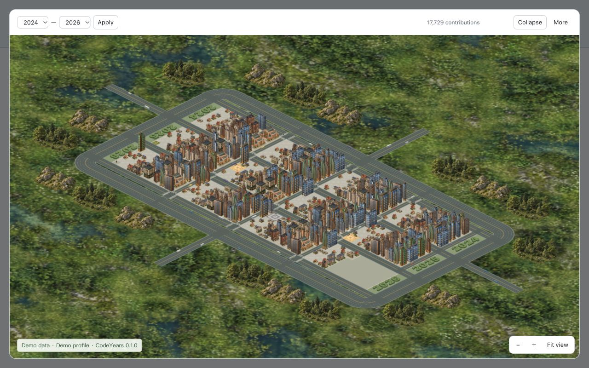
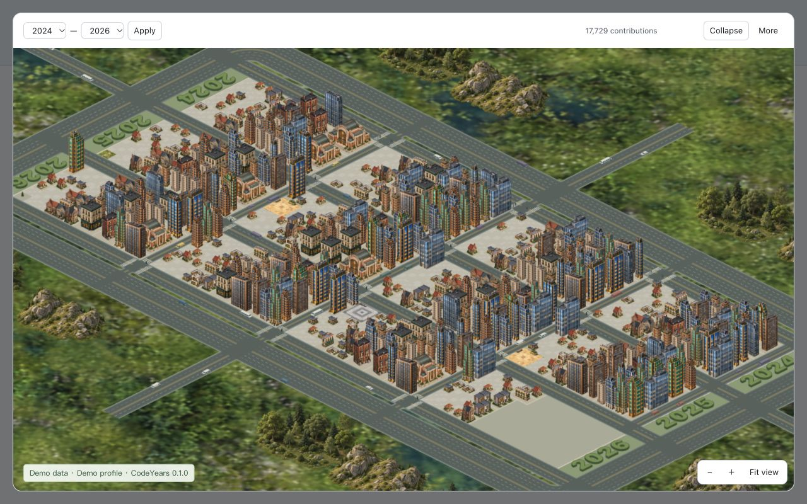
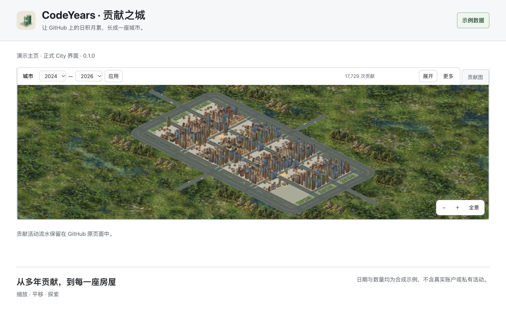

# CodeYears 0.1.0 商店媒体包

制作日期：2026-11-03。状态：正式待上传素材，未操作商店控制台、未上传或提交审核。沿用首发候选 City，不展示 Terrain、未实现主题或新的缩放工具条。

## 上传位置

本次按用户控制台的实际要求，为全球与每个当地语言分别保留至少一张截图；不会用全球英文图代替 English 当地截图。

| 控制台位置 | 文件 | 内容与规格 |
| --- | --- | --- |
| 全球截图 | [global/01-city-overview.jpg](global/01-city-overview.jpg) | 英文城市全景；1280×800 RGB JPEG |
| English 当地截图 | [localized/en/01-neighborhood-detail.jpg](localized/en/01-neighborhood-detail.jpg) | 英文楼宇与街区近景；1280×800 RGB JPEG |
| 简体中文当地截图 | [localized/zh_CN/01-profile-controls.jpg](localized/zh_CN/01-profile-controls.jpg) | 中文页内标签、年份范围、展开和缩放入口；1280×800 RGB JPEG |
| 小型宣传图块 | [global/small-promo.png](global/small-promo.png) | 全球通用；440×280 RGB PNG |
| 顶部宣传图块 | [global/marquee-promo.png](global/marquee-promo.png) | 全球通用；1400×560 RGB PNG |

三张截图放在不同槽位，不重复上传同一张。按官方排列说明，English详情页应先显示英文近景、再显示全球英文全景；简体中文详情页应先显示中文操作图、再显示全球英文全景。本次没有在商店预览实际排列，不把此预期写成已上传验收。

宣传图块不支持分别本地化，因此只使用统一 CodeYears 品牌名和示例标签；没有需要另行翻译的长文案。尺寸、格式和顺序依据2026-11-03读取的[商店详情说明](https://developer.chrome.com/docs/webstore/cws-dashboard-listing)与[图片规范](https://developer.chrome.com/docs/webstore/images)，最终仍以用户控制台字段为准。

## 预览

全球英文全景：



English 当地近景：



简体中文当地操作：



小型与顶部宣传图块：


## 来源与复现

- 源码基线为 CodeYears main `118d18a95013bb1a255ecfd8142a425d7baaa08c`。实际使用本机现有0.1.0正式候选的入口、面板、渲染器和运行图片；三个JS文件均逐字节与发行ZIP比对一致。未修改产品源代码、清单、权限或发行包。
- 本地Chrome独立窗口，视口1280×800。三张JPEG直接由浏览器捕获为最终商店截图，未事后重画文字、翻译像素、拼接控件或补画功能；不是验收过程截图改名。
- 演示页是本机受控外壳，提供类似贡献区的结构、年度入口及合成响应；不是实际GitHub个人主页或登录会话。入口闭包接收演示location，面板模块由局部location/fetch映射到本机数据响应，chrome.storage和语言接口仅为演示内存替身。程序主体和渲染实现不改，但这些环境适配不等于真实MV3运行。
- 所有界面通过正式入口实际点击“城市/City”激活。等待汇总显示17,729次、1038天，且加载完成后捕获。全球图：展开后放大一次；英文近景：相对默认展开全景共放大三次；中文图：保持页内模式、相对默认放大两次。倍率每次1.25，未平移。展开图内的Demo标签由外壳添加，用于披露示例，不属于产品新功能。
- 合成数据沿用[旧版输入算法](../README.md#确定性输入算法)：初始seed20240101，跨年连续迭代，截止日改为2026-11-03。2023用于必要的源年入口；默认呈现2024–2026。没有读取真实GitHub、Cookie、账户缓存、Token或私有活动。未来复作需在演示环境固定同一日期，或如实更新截止日和总数，不修改产品日期逻辑。
- 宣传图块使用同一场景在展开全景放大一次时的原始Canvas PNG（1238×703 RGBA），经独立设计页制作品牌构图；未以JPEG二次压缩输入。原始画布SHA-256为 `66c51033e7f97ba62ac8c7fd0e007aeb9c21fd59a23d31c24945f0ecd76f2e94`。设计方向见[ART_DIRECTION.md](ART_DIRECTION.md)，可维护的构图参数见[SOURCE.md](SOURCE.md)。
- 图标及城市素材沿用现有项目资源，权利与来源继续以[ASSETS.md](../../../../ASSETS.md)和[第三方说明](../../../../THIRD_PARTY_NOTICES.md)为准；代码MIT不自动授予城市位图独立复用许可。宣传图块的深绿色品牌衬底不代表产品新增深色主题或夜景。

## 验证与留存

五张图片均检查实际尺寸、RGB无透明通道、完整解码和SHA-256；按原尺寸及宣传图块半尺寸目视核对主体、文字、裁切、示例标签和语言。只验证媒体制作，不重复扩展构建、真实MV3/存储或性能验收，不把演示结果迁移为这些项目的证据。

可在本目录重复执行规格检查：

```sh
python3 - <<'PY'
from pathlib import Path
from PIL import Image
import hashlib
expected = {
  'global/01-city-overview.jpg': (1280, 800),
  'localized/en/01-neighborhood-detail.jpg': (1280, 800),
  'localized/zh_CN/01-profile-controls.jpg': (1280, 800),
  'global/small-promo.png': (440, 280),
  'global/marquee-promo.png': (1400, 560),
}
for name, size in expected.items():
    path = Path(name)
    with Image.open(path) as image:
        image.load()
        assert image.size == size and image.mode == 'RGB', name
    print(name, path.stat().st_size, hashlib.sha256(path.read_bytes()).hexdigest())
PY
```

仅长期保留五张事先指定的正式商店素材、设计说明和本报告。演示HTML、数据响应、设计预览页、原始导出PNG及临时服务在完成后清理；不纳入Git。旧两张正式PNG保留为历史版本。
