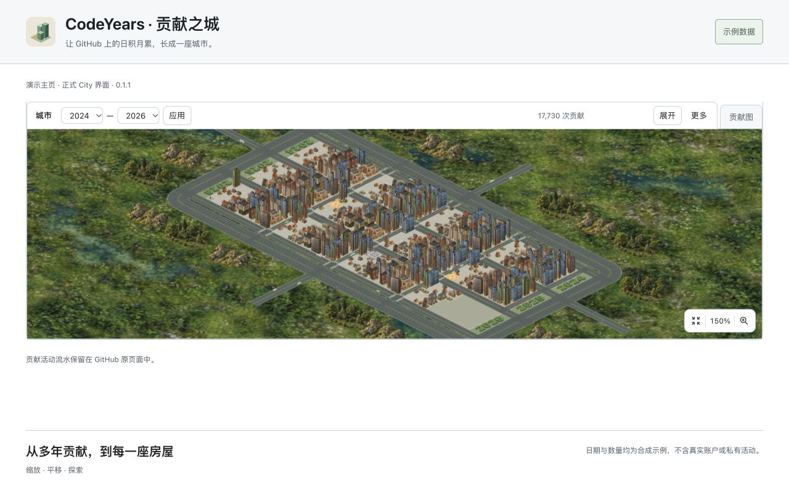
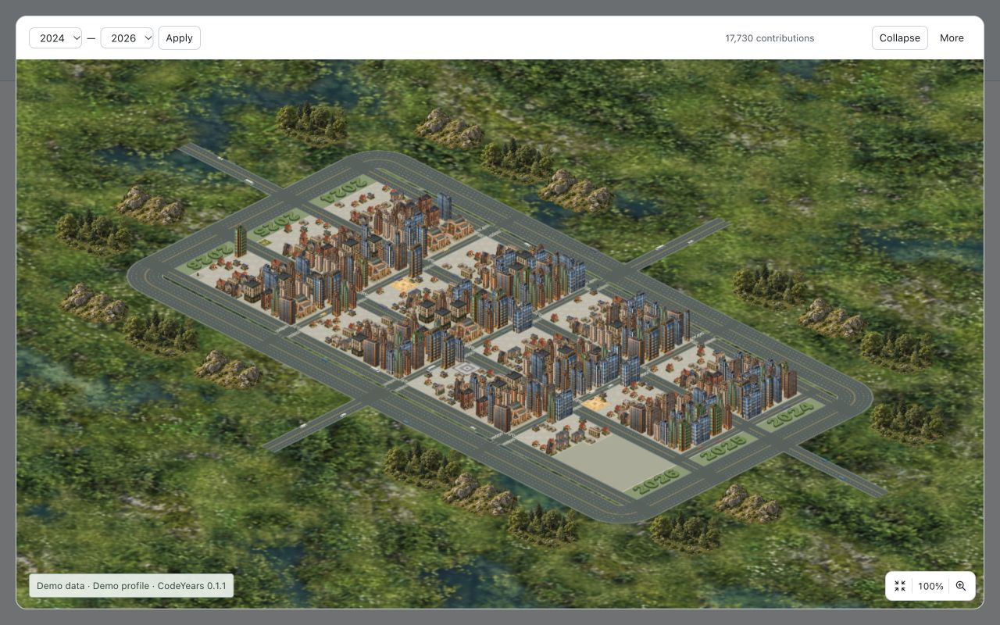

# CodeYears 0.1.1 商店上传材料

制作日期：2026-11-04。正式素材已完成，未代填商店、未上传或提交审核。用户保留最终提交审核操作；浏览器工具明确禁止控制扩展商店后台，因此本次提供完整上传文件。

## 上传分组与顺序

每组独立包含三张，不依赖全球组补足当地语言组。先移除各组原有的旧单图，再按01→02→03上传对应组，避免重复。

| 后台位置 | 上传目录 | 顺序 |
| --- | --- | --- |
| 全球截图 | `global/` | `01-city-overview.jpg`、`02-neighborhood-detail.jpg`、`03-profile-controls.jpg` |
| English当地截图 | `localized/en/` | 同上三张；与全球组内容、顺序及文件字节相同 |
| 简体中文当地截图 | `localized/zh_CN/` | 对应的中文三张；不要混入英文截图 |
| 小型宣传图块 | `global/small-promo.png` | 440×280，原图块未改，可保留后台现有文件 |
| 顶部宣传图块 | `global/marquee-promo.png` | 1400×560，原图块未改，可保留后台现有文件 |

九个截图文件（六张不同语言图片与三张英文副本）均为1280×800、RGB JPEG。分组依据[商店详情本地化](https://developer.chrome.com/docs/webstore/cws-dashboard-listing)及本项目0.1.0上架后的实际回退观察；规格依据[官方图片说明](https://developer.chrome.com/docs/webstore/images)。未单独提供语言使用全球英文组；上传后仍需检查各语言预览。

名称来自0.1.1软件包：英文`CodeYears: GitHub Contribution City`，简体中文`CodeYears：GitHub 贡献之城`。详细说明可使用[当前商店文案](../../STORE_LISTING.md)。上传`release/codeyears-0.1.1-city.zip`后核对版本0.1.1，再保存各语言组；最终“提交审核”由用户执行。

## 截图预览

中文操作图：

英文全景：

其他四张位于各语言目录；完整尺寸、格式、字节数和SHA-256见[media.json](media.json)。

## 来源与复现

0.1.1使用PR #58–#61已合入后的正式入口、面板、渲染器及运行图；本轮仅同步版本号，不改变运行逻辑。六张JPEG由本机Chrome156.0.8078.80实际操作正式构建后直接截图，没有事后翻译文字、拼接控件或重画画布。旧0.1.0媒体包保持原样。

旧图包含0.1.0标注及加减按钮，因此重拍同样的场景/取景；图块没有版本号或操作控件，按原字节复用。新画面展示当前“全景图标｜比例｜最大图标”，页内初始150%，不增加未实现功能。

本地外壳仅监听`127.0.0.1:4197`，视口1280×800。正式`entry.js`包在只提供演示location的闭包内；正式`content.js`前置局部location/fetch适配，随后原模块字节不改；`landscape.js`及全部运行PNG字节不改。Chrome runtime资源URL映射本机正式dist；storage与语言使用演示内存接口。年度请求映射合成英文HTML及相应Response URL，经正式解析器/ISO筛选/标定后的当前运行加载器绘制，不请求真实GitHub、Cookie、账户缓存或私有活动。

合成输入沿用[0.1.0输入算法](../city-0.1.0/README.md#确定性输入算法)：从2023-01-01以seed20240101跨年连续迭代，截止日更新为2026-11-04。默认显示2024–2026、1039天、17730次示例贡献。日期与数量均明确标为示例，不冒充真实账户。复作时固定该输入，或如实更新截止日和数量，不改产品日期规则。

拍摄顺序：先在每种语言下点击正式City/城市，等待三年加载和短填入动画完成。操作图保持页内初始150%；全景图实际点击展开、全景后，对聚焦画布按一次Shift+Equal，显示100%；近景再按两次，显示156%。无平移，More关闭。展开图左下角示例标签来自外壳，仅作披露；截图前点击该标签移开画布键盘焦点，不更改取景。语言由演示内存偏好选择，未事后修改截图文字。

目视检查两种语言的三种构图：主要街区、楼宇边缘、工具条、中文/英文标签与版本可读，无加载/失败遮罩。Pillow只用于只读完整解码、尺寸/模式及SHA-256检查，没有重编码或编辑。全球与英文三个文件逐字节比对一致，宣传图块与旧媒体包逐字节一致。

## 留存与范围

仅保留预先指定的正式商店图片、元数据和本说明。临时外壳、合成响应、语法检查文件、服务与浏览器标签页已在完成后关闭清理。截图是媒体制作结果，不替代真实MV3/存储、商店签名包、Edge或硬件性能验收；实际运行与画质证据见[预烘焙报告](../../reports/CITY-PREBAKED-ASSETS.md)。
