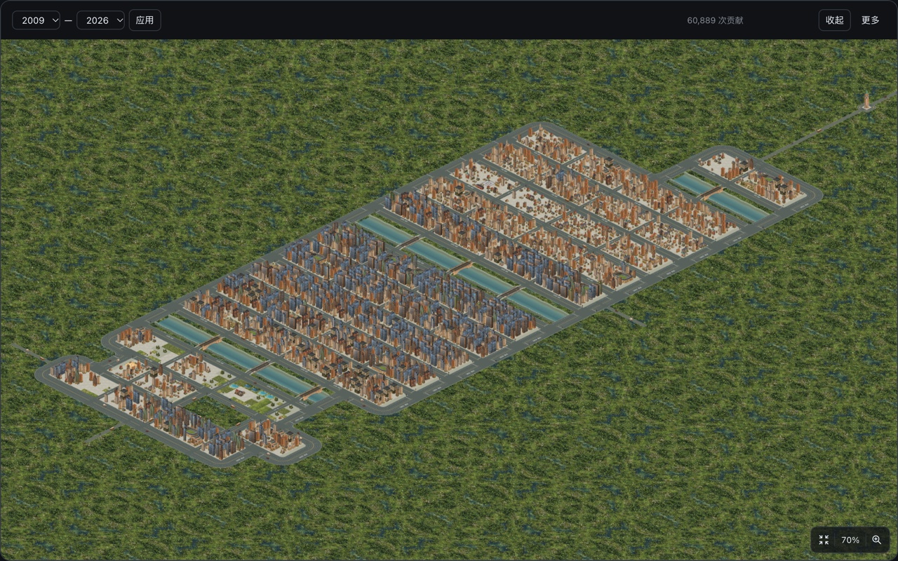
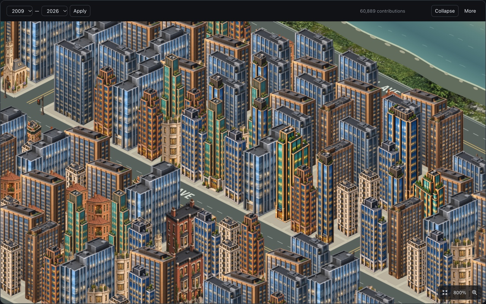
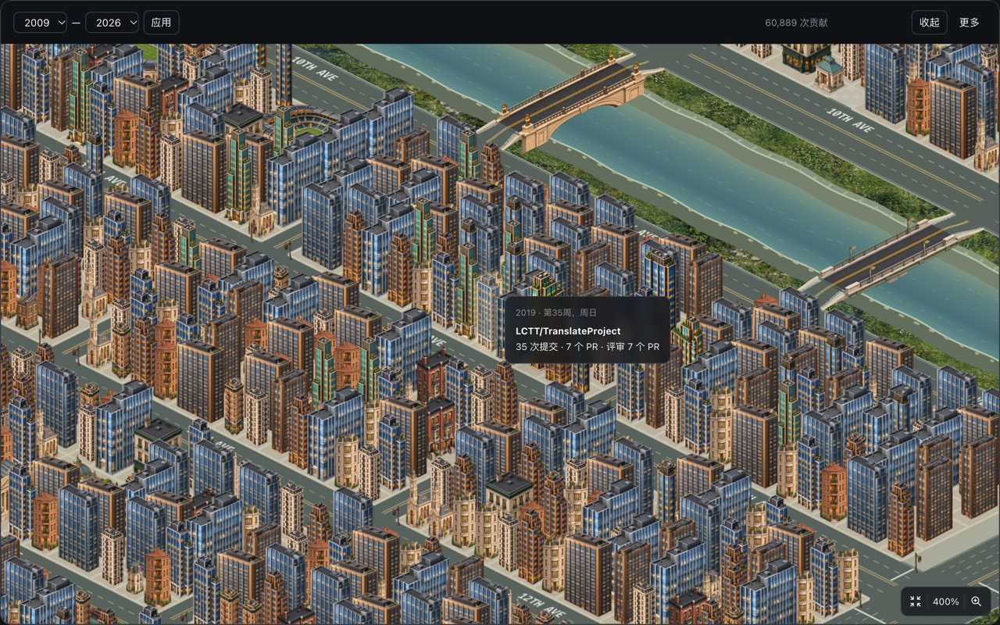

# CodeYears 0.1.2 商店截图

制作日期：2026-11-08。维护者明确授权以自己的GitHub贡献页作为图例，并要求展示完整的大城市和更高倍率的近景。新图来自本机Chrome实际运行的CodeYears 0.1.2。维护者随后确认0.1.2已于当日提交Chrome商店审核；审核通过与新版上线尚未确认，工具未操作或读取商店后台。0.1.0/0.1.1历史媒体完整保留。

## 上传分组

每个语言组包含三张，按下表顺序上传；全球组是英文组三张的逐字节副本。先替换对应组的旧截图，避免新旧混用。截图均为1280×800 RGB JPEG。

| 顺序 | 文件 | 画面 |
| --- | --- | --- |
| 01 | `01-city-overview.jpg` | 70%多年全景：2009–2026全部城区、河流和注册塔 |
| 02 | `02-neighborhood-detail.jpg` | 800%近景：高楼立面、低层建筑、道路与街景细节 |
| 03 | `03-building-activity.jpg` | 400%街区：建筑高光与真实公开项目摘要，包含河道和两种桥梁 |

| 商店位置 | 目录 |
| --- | --- |
| 全球截图 | `global/` |
| English当地截图 | `localized/en/` |
| 简体中文当地截图 | `localized/zh_CN/` |
| 小型宣传图块 | `global/small-promo.png`，440×280，原字节沿用0.1.1，可保留后台现有图 |
| 顶部宣传图块 | `global/marquee-promo.png`，1400×560，原字节沿用0.1.1，可保留后台现有图 |

中英文内容和功能一致；不要只上传全球组来补足当地组。规格与语言槽位见[官方商店说明](https://developer.chrome.com/docs/webstore/cws-dashboard-listing)。名称、简短说明与权限保持当前0.1.2包内设置，详细文案见[商店材料](../../STORE_LISTING.md)。

## 预览

中文完整城市：

英文800%近景：

中文悬停摘要：

## 真实数据与来源

- 页面：[维护者wxy的GitHub主页](https://github.com/wxy/)。显示范围2009–2026，画面总量60,889次贡献，均由正式扩展在当前GitHub会话中读取并呈现；不是合成输入。总量为拍摄时快照，后续页面变化可能使复作结果不同。ISO周年与公历年的口径继续以产品规则为准。
- 悬停选中2019年第35周周日的建筑，实际浮层显示公开仓库[LCTT/TranslateProject](https://github.com/LCTT/TranslateProject)：35次提交、7个PR、评审7个PR。只把该浮层当作可见记录的解释性汇总，不作为完整项目统计或工时。没有具体事项标题、私有仓库名或访问者身份栏。
- Chrome 157.0.8103.38、macOS、深色GitHub界面。在原生扩展管理页核对旧解压版0.1.1，实际点击重新加载后确认0.1.2，再刷新主页后开始正式拍摄。正式运行版本对应[0.1.2发布提交ae88de9](https://github.com/wxy/CodeYears/commit/ae88de94237f76c5f2d718abc3822832e7dc3753)。未引入实验PR、修改运行逻辑或素材。
- 直接操作已登录Chrome的原生界面：年份选择、应用、展开、滚轮缩放、拖动平移、悬停及语言菜单。未向GitHub注入脚本、拦截响应、替换计数、重画画布或添加模拟控件；没有读取浏览器资料文件、Cookie、Token或保存贡献HTML/缓存。
- 只捕获展开城市对话框，避开浏览器标签栏、通知页、账户菜单和无关页面；未添加宣传文字或遮盖产品内容。

## 取景与复作

1. 加载正式0.1.2扩展并刷新维护者贡献页，打开城市，选择2009–2026后点击应用。等待全年份载入和填入动画结束，确认总量与画面完整、无读取或失败遮罩。
2. Chrome窗口边界为`{0,30,1320,957}`，页面视口1320×840 CSS像素。展开对话框的原生边界为`{20,137,1280,800}`；用系统截图按这个矩形直接捕获。Retina屏幕比例2，原始捕获2560×1600。
3. 全景：点击正式全景按钮回到50%；在画布中心滚轮放大到显示70%，平移使全部城区和注册塔入镜。截图保留实际倍率与60,889总数。中文/英文在同一取景下由正式语言菜单切换。
4. 近景：从全景中心继续滚轮放大到800%，移开鼠标让浮层关闭；保留该城区的高楼、道路和河岸细节，拍摄两种界面语言。
5. 摘要：在近景中悬停选定的2019年建筑，取得公开项目后，以同一悬停点为锚缩到400%，重新稳定悬停到取数完成。保留高光与项目/数量摘要，拍摄两种语言。
6. 仅作等比尺寸与格式导出：`sips -z 800 1280 -s format jpeg -s formatOptions 90 <capture.png> --out <final.jpg>`。没有拼接、修图、后补翻译、锐化或改变内容。最终JPEG完整解码并核对1280×800、RGB、语言、文字、倍率及SHA-256。
7. 全球三个JPEG从英文组直接复制并逐字节比对；两个宣传图块与0.1.1原图逐字节相同。拍摄后恢复原语言“跟随浏览器”、原窗口尺寸，关闭本次专用管理页并收起展开画布。

实际检查通过：九张JPEG均可完整解码、尺寸1280×800且模式RGB；每张画面的语言、倍率、总量、建筑和文字均目视核对；全球/英文副本及两个既有图块逐字节匹配；文档引用与归档ZIP CRC正常。本轮仅制作图片和说明，未改运行源码、依赖或配置，因此不重复本地构建。未完成载入或取数的试拍图不进入正式媒体。

## 交付与留存

保留九份JPEG、两份既有宣传PNG、[media.json](media.json)及本说明；归档包在本机`release/codeyears-store-media-0.1.2.zip`，不提交Git。文件规格、字节数、SHA-256与真实数据来源均在media.json中记录。正式素材随0.1.2发布归档，官网图片由独立同步PR处理；既有0.1.2运行ZIP保持原样。

临时原始屏幕捕获、原生操作脚本/二进制、编译缓存和检查过程文件在交付完成后清理。截图只证明这些实际画面与功能展示，不代替完整账户/权限矩阵、跨浏览器或硬件性能验收。
